# Report v1.7, updated 2026-11-18

> English edition of the current Markdown report, translated from the Vietnamese original in report.md. The linked research notes are in Vietnamese: mini build results, P1 acceptance, P2 acceptance, P3 acceptance, P4 acceptance, extra toolchain and loader measurements.

<a id="s00"></a>

# Primer: what Windows does when you open an exe file, and what that file is made of

> **TL;DR** An exe file is a box with a table of contents at the front (called the PE header) and a few compartments holding code and data (called sections). When you double-click it, Windows reads the table of contents, creates an empty process, places the compartments in memory, loads the DLLs the file asks for, then jumps to the first instruction. The file gets smaller when you drop the runtime library, drop spare compartments and drop padding bytes. RAM goes down in a completely different way: load fewer DLLs, create no unneeded windows, open no console.

This part is for readers who are not yet familiar with how an exe runs. Every term is explained where it first appears. The figures for each file are read by the script `build/pe-anatomy.py` from the headers of the project's own files. The steps Windows performs in section 3 are general Windows knowledge; wherever a step was re-measured on this machine, the source is cited.

**What this part covers.** Section 1 states the phenomenon. Section 2 is a word list; skim it and come back when you meet an unfamiliar word. Sections 3 to 6 answer "what is an exe file made of, and what can be removed". Section 7 answers "why a small file does not mean less RAM". Sections 8 to 10 are common misconceptions, the price paid, and a one-sentence summary. After this part, [Part 1](#s01) gives the conclusions of the whole report; the parts after it go deeper into each topic and can be read in any order.

## 1. The phenomenon: the same program printing one line can be a 268 byte file or a 1.4 MB file

The eight files below are all valid Windows programs. Seven print "Hello, World!"; the smallest only returns a number.

| File | Size | Sections | DLLs requested |
|---|---|---|---|
| PE hand-written in Python | 268 B | 0 | none |
| NASM, hand-built PE | 584 B | 1 | KERNEL32, 3 functions |
| MSVC C without CRT, tuned | 768 B | 2 | KERNEL32, 3 functions |
| MSVC C without CRT, default flags | 2,560 B | 3 | KERNEL32, 3 functions |
| MSVC C with dynamic CRT | 9,728 B | 5 | 7 DLLs, 35 functions |
| MSVC C with static CRT | 111,104 B | 6 | KERNEL32, 71 functions |
| Rust std | 108,032 B | 6 | 10 DLLs, 79 functions |
| Go | 1,478,656 B | 8 | kernel32, 47 functions |

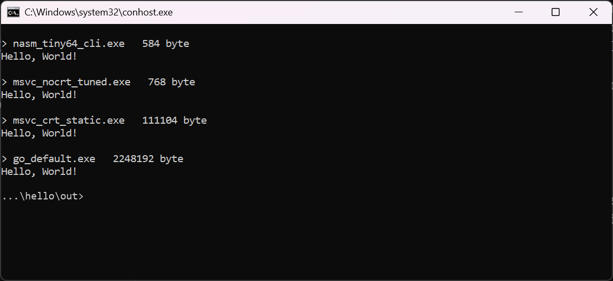

The actual code of the Hello World program in C is only **60 bytes** long. Everything else in the file is something else. To know what can be removed, you need to know what Windows requires of an exe file.

## 2. A few words to know first

- **Byte and offset.** A file is a sequence of bytes numbered from 0. An offset is the position number of a byte. Offsets are usually written in base 16 with the prefix `0x`: `0x3C` is byte number 60, `0x40` is byte number 64
- **Header.** The front of the file, acting as a table of contents: it says what the rest of the file contains and where it is
- **PE.** Short for Portable Executable, the name of the file format of Windows exe and dll files
- **Section.** One compartment in the file. Each compartment holds one kind of content and has its own permissions: `.text` holds machine code and may be executed, `.rdata` holds read-only data, `.data` holds writable data
- **DLL.** A library file holding shared functions. `kernel32.dll` holds basic functions such as writing a file or exiting the program
- **Import.** The list of "I need function X from DLL Y" that the exe file records in advance. Hello World needs three functions from KERNEL32: `GetStdHandle`, `WriteFile`, `ExitProcess`
- **Entry point.** The address of the first instruction that will run
- **CRT.** C Runtime, the runtime library of C. It prepares everything before calling `main` and provides `printf`, `malloc`
- **Loader.** The part of Windows whose job is to bring the exe file into memory and connect it to its DLLs
- **Process.** A running program, with its own memory area. A **thread** is one stream of instructions running inside a process
- **Page.** Windows divides memory into 4,096 byte cells called pages. Memory is handed out by the page, not by the byte

## 3. From the double-click to the program running: seven steps

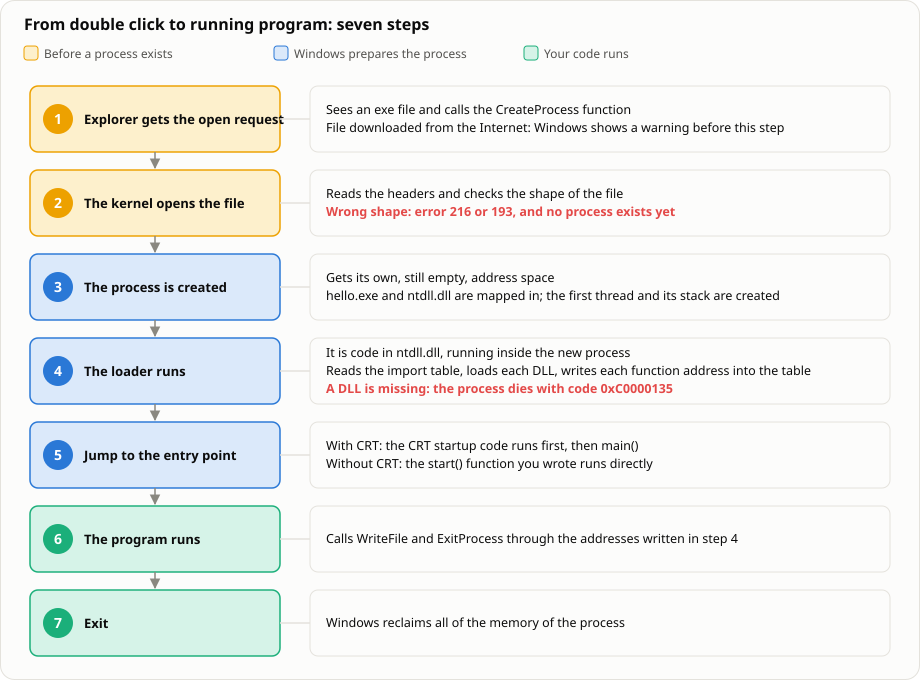

Three takeaways from the diagram:

- **Step 2 reads only the header.** Windows decides whether to accept or reject the file before running any of your instructions. The 268 byte rule in [Part 4](#s04) is a check at this step: a shorter file is rejected with error 216 [R1-M1]
- **Step 4 is where most of the work goes.** Every requested DLL has to be found, brought into memory and initialized. That DLL in turn requests other DLLs. This is also the main source of RAM cost, see section 7
- **Step 5 is where the CRT cuts in.** An ordinary C program does not start at `main`. It starts at a CRT function, which prepares the heap, the input and output streams and the command-line arguments, and only then calls `main`

The two errors at step 2 and the code `0xC0000135` at step 4 were all encountered in the project's tests: files under 268 bytes, and the sample using the dynamic CRT running on a clean virtual machine without `VCRUNTIME140.dll`.

## 4. Inside an ordinary exe file: 2,560 bytes, of which 1,440 bytes are padding

This is the real layout of the MSVC C build without CRT using default flags, the file `poc/hello/out/msvc_nocrt_plain.exe`.

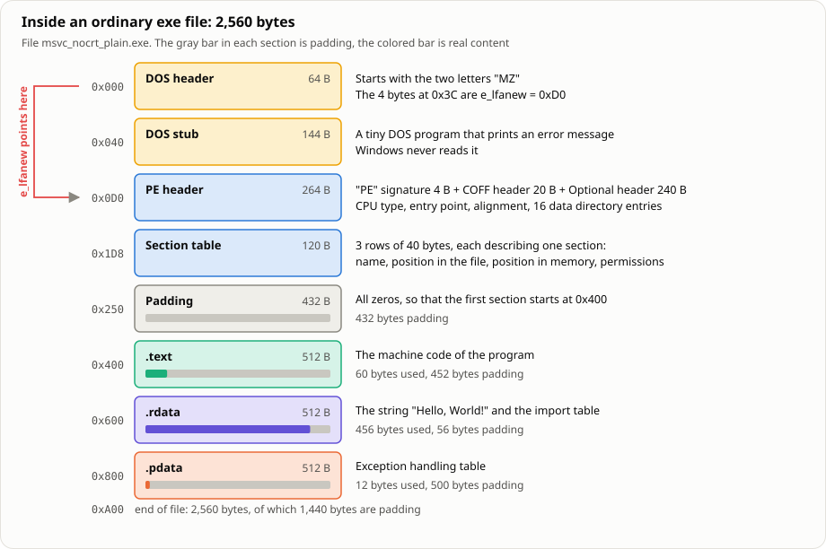

```
offset   size        content
0x000    64 B        DOS header      starts with the two letters "MZ"
                                     last 4 bytes (at 0x3C) are e_lfanew = 0xD0
0x040    144 B       DOS stub        tiny DOS program that prints
                                     "This program cannot be run in DOS mode"
0x0D0    4 B         "PE" signature  <- e_lfanew points here
0x0D4    20 B        COFF header     CPU type, number of sections (3)
0x0E8    240 B       Optional header entry point, alignment, image size,
                                     16 "data directory" slots (where imports are, ...)
0x1D8    120 B       Section table   3 rows x 40 bytes, each row describes one compartment
0x250    432 B       padding         all zeros, so the first compartment starts at 0x400
0x400    512 B       .text           machine code: 60 bytes used, 452 bytes padding
0x600    512 B       .rdata          the string "Hello, World!" and the import table:
                                     456 bytes used, 56 bytes padding
0x800    512 B       .pdata          exception handling table: 12 bytes used, 500 padding
0xA00                end of file (2,560 bytes)
```

The figure below is that same file opened in ImHex, an open-source hex viewer. Each row is 16 bytes; the left column gives the address of the first byte of the row, and the right column shows the same bytes as text. Background tints mark each part exactly as in the listing above, and gray areas are padding. Each numbered circle marks one header field, with the value read from the file itself. This is the real ImHex window, stitched from five captures at different scroll positions; all-zero stretches are left out to keep the figure compact.


*ImHex 1.38.1 capture on this machine, 2026-11-19. Tints, numbers and labels were drawn by `build/make-hex-figure.py`; the values in the labels are read from the exe file by the script.*

Each piece explained:

- **DOS header and `e_lfanew`.** The exe format dates from the DOS era, so the file still opens with a 64 byte DOS-style header. Windows today uses exactly two places in it: the two letters `MZ` at the start, and the four bytes at offset `0x3C`. Those four bytes are named `e_lfanew`, meaning "address of the new header". It is a pointer: "the real PE header is at this offset". In the file above it equals `0xD0`, that is byte number 208
- **DOS stub.** A small DOS program that only runs if someone opens this file in DOS. Windows never reads it. It can be removed entirely
- **PE signature, COFF header, Optional header.** These three blocks are 4 + 20 + 240 = **264 bytes** long and are the real table of contents. The number 264 is exactly the second half of the rule "the file must be at least `e_lfanew` + 264 long". The name "Optional" is misleading: for an exe file this block is mandatory
- **Section table.** Each compartment costs one 40 byte row recording its name, its position in the file, its position in memory and its permissions
- **Padding bytes.** By default the linker forces every compartment to start at an offset divisible by 512. This value 512 is named `FileAlignment`, the alignment within the file. The `.text` compartment has only 60 bytes of code but occupies 512 bytes. In total, 1,440 of the file's 2,560 bytes are zeros used as padding

When brought into memory, the compartments are spread out using a different alignment, `SectionAlignment`, 4,096 bytes by default, exactly one page:

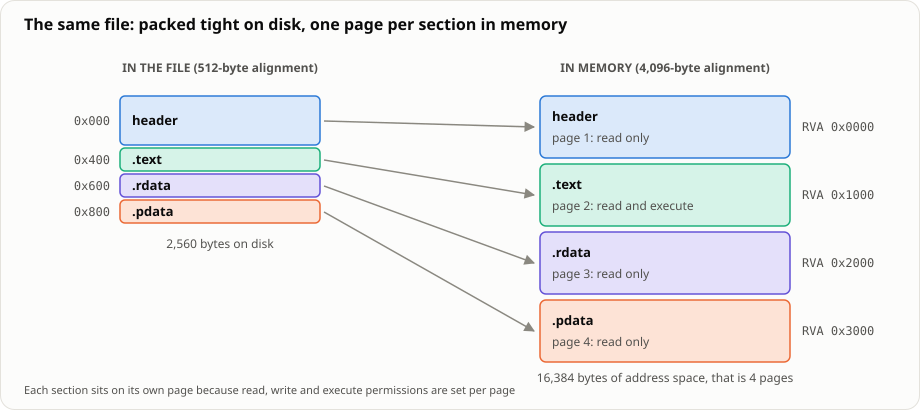

An **RVA** is an address counted from the start of the file once the file is in memory. The entry point of this file is RVA `0x1000`, the first byte of `.text`. Each compartment sits on its own page because access permissions are set per page: a code page may be executed but not written, a data page the other way around.

## 5. An exe file written in Python: 268 bytes, no compartments at all

An exe file is just bytes placed in the right spots, so it can be created in any language that can write a file. The script `poc/pe268/make268.py` creates the smallest exe file that Windows 11 x64 agrees to run. The file returns exit code 42 and is byte-for-byte identical to the sample tested in the project.

```python
import struct
buf = bytearray(268)                              # 268 bytes, all zeros
buf[0x00:0x02] = b"MZ"                            # DOS signature
buf[0x04:0x08] = b"PE\0\0"                        # PE signature, placed right at byte 4
struct.pack_into("<H", buf, 0x08, 0x8664)         # CPU type: x64
struct.pack_into("<H", buf, 0x0A, 0)              # number of sections: 0
buf[0x0C:0x10] = bytes([0x6A, 0x2A, 0x58, 0xC3])  # machine code: push 42; pop rax; ret
struct.pack_into("<H", buf, 0x18, 0xF0)           # Optional header is 240 bytes long
struct.pack_into("<H", buf, 0x1A, 0x0022)         # is an executable file
struct.pack_into("<H", buf, 0x1C, 0x020B)         # 64-bit style header
struct.pack_into("<I", buf, 0x2C, 0x0C)           # entry point: byte 0x0C
struct.pack_into("<Q", buf, 0x34, 0x140000000)    # preferred load address
struct.pack_into("<I", buf, 0x3C, 4)              # SectionAlignment = 4 = e_lfanew
struct.pack_into("<I", buf, 0x40, 4)              # FileAlignment = 4
struct.pack_into("<HH", buf, 0x4C, 6, 0)          # subsystem version 6.0
struct.pack_into("<I", buf, 0x54, 0x200)          # needs 512 bytes of memory
struct.pack_into("<H", buf, 0x60, 2)              # GUI subsystem: opens no console
struct.pack_into("<QQ", buf, 0x64, 0x100000, 0x1000)  # stack
struct.pack_into("<QQ", buf, 0x74, 0x100000, 0x1000)  # heap
open("tiny268.exe", "wb").write(buf)
```

Compared with the ordinary file in section 4, this file uses three tricks:

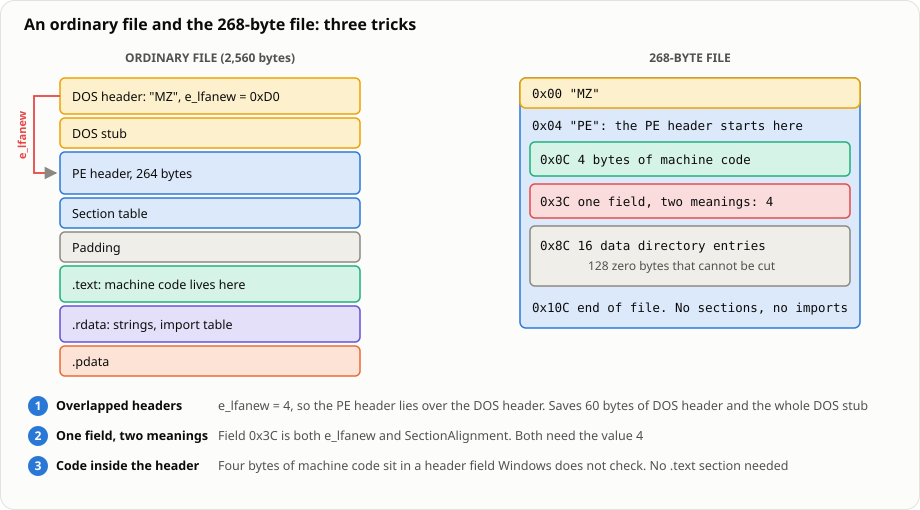

- **Overlapped headers.** `e_lfanew` equals 4, so the PE header starts at byte 4 and lies on top of the DOS header. This saves 60 bytes of DOS header and the entire DOS stub
- **One slot, two meanings.** Offset `0x3C` is both the `e_lfanew` of the DOS header and exactly the `SectionAlignment` slot of the PE header. Both need the value 4, so one slot serves both
- **Code inside the header.** Four bytes of machine code are placed in a header slot that Windows does not use. The file needs no `.text` compartment

From byte `0x8C` to the end of the file there are 128 zero bytes. These are the 16 data directory slots, all left empty. They hold nothing but cannot be cut: Windows requires the file to be a full 4 + 264 bytes long [R1-M1].

The price: this file cannot call any Windows function in the usual way, because when a file has no sections the import table is ignored [R1-M8]. It can do only one thing, which is return a number.

## 6. What the compiled Hello World builds contain

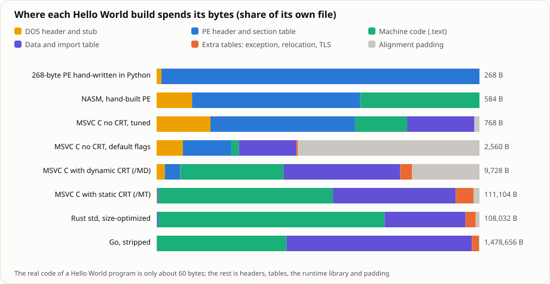

*Source: `build/pe-anatomy.py` reads the header of each file, results in `data/pe-anatomy.json`. Each bar is 100% of its own file; bar lengths cannot be compared with one another*

Reading from top to bottom goes from the minimal file to the full one:

- **268 B, Python.** All header. Nothing else
- **584 B, NASM.** A 64 byte DOS header with no stub, a 304 byte PE header with one section row, and one 216 byte compartment holding code, strings and the import table together. No padding because the alignment is 4
- **768 B, MSVC tuned.** Two compartments, alignment 16. A 124 byte `.text` compartment and a 160 byte `.idata` compartment holding the import table. The DOS stub is kept, so `e_lfanew` is 128
- **2,560 B, MSVC default flags.** Same source code as the 768 B build. The difference is three separate compartments and alignment 512, which makes 56% of the file padding
- **9,728 B, dynamic CRT.** Code grows from 60 to 3,112 bytes because the CRT startup part is added. The import table gets longer: 7 DLLs, 35 functions. `printf` itself is not in the file; it lives in the CRT's DLL
- **111,104 B, static CRT.** All the CRT parts that are needed are copied into the file: 59,936 bytes of code, 39,216 bytes of read-only data. Only KERNEL32 is still requested, but as many as 71 functions
- **108,032 B, Rust std.** Same structure as the static CRT build: Rust's standard library is copied into the file
- **1,478,656 B, Go.** 594 KB of code and 804 KB of read-only data. The Go runtime, consisting of the garbage collector, the scheduler and the type information tables, always comes along

Commonly seen compartments and whether they can be removed:

| Compartment or part | What it holds | Can it be removed |
|---|---|---|
| DOS stub | DOS program that prints an error line | Yes. Windows does not read it |
| `.text` | Machine code | No, unless the code is hidden in the header as in the 268 B file |
| `.rdata`, `.idata` | Strings, constants, import table | Can be merged into `.text` to save one 40 byte row and the padding |
| `.data` | Writable global variables | Can be removed if the program has no global variables |
| `.pdata` | Table that helps Windows handle exceptions on x64 | Can be merged. Removed entirely, the program cannot catch exceptions |
| `.reloc` | List of places to patch if the file is loaded at a different address | Can be removed with `/FIXED`, at the cost of losing ASLR |
| `.rsrc` | Icon, manifest, version information | Can be removed if no icon or manifest is needed |
| Debug directory | Path to the debugging file | Yes, with `/DEBUG:NONE` |
| Padding bytes | Zeros | Reduced with `/ALIGN:16 /FILEALIGN:16` |
| CRT | Startup, `printf`, `malloc` | Yes, with `/NODEFAULTLIB` and a hand-written entry point |

**ASLR** is the mechanism by which Windows loads a file at a random address on every run to make things harder for malware. Loading at a different address requires the `.reloc` compartment. The 768 B build drops this compartment, and the virtual machine test shows the consequence: when Windows enables the mandatory ASLR policy, the file is rejected with error code 623.

Order of removal, by measured bytes saved:

1. **Drop the CRT**: 111,104 down to 2,560 bytes. This is the biggest step and has no compatibility risk
2. **Reduce alignment and merge compartments**: 2,560 down to 768 bytes. Outside what the official documentation covers; has run on build 26300, 24H2 and 25H2
3. **Hand-build the PE, drop the DOS stub**: 768 down to 584 bytes. Requires writing assembly
4. **Overlap the headers, drop imports**: 584 down to 268 bytes. The program can no longer do anything useful

### Each file opened in ImHex

The chart above only shows proportions. The figures below open each file in ImHex to show what each approach actually produces. They read like the figure in section 4: background tints are the parts of the file, numbered circles are the notable fields, and the values in the labels are read from the file itself by `build/make-hex-figure.py`. Small files are drawn in full. For large files only the headers and the section table are drawn, and each remaining section becomes one line with its address and size. The 2,560 byte MSVC build with default flags already has its figure in section 4.

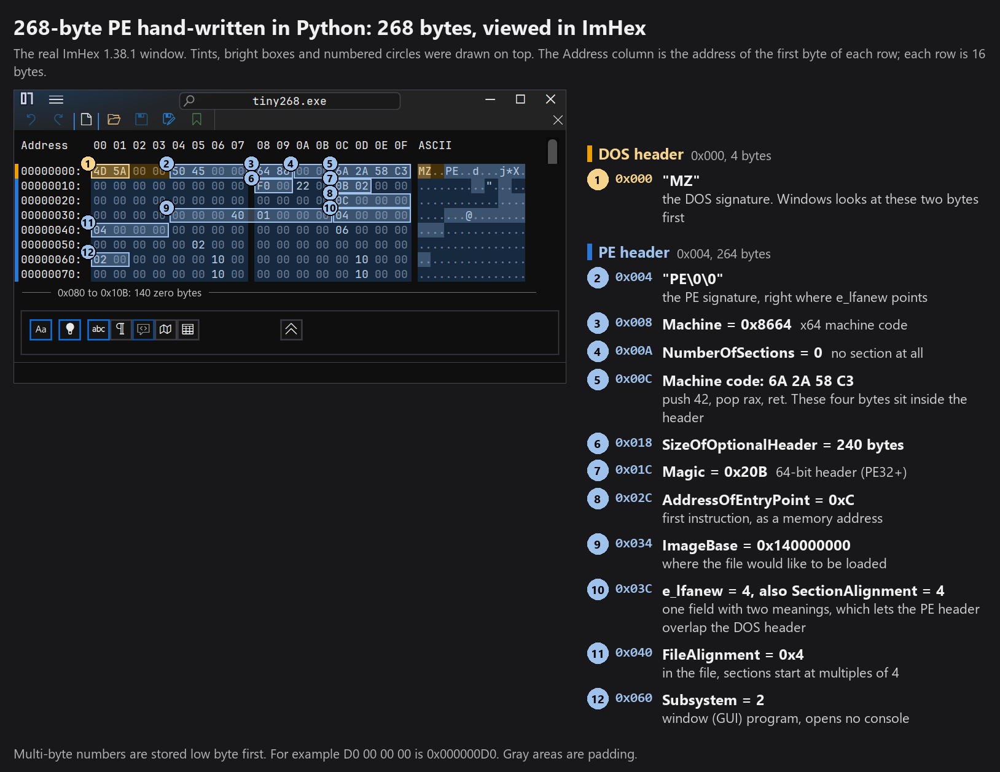

**268 bytes, hand-written in Python.** The whole file has only 8 rows with content. The PE signature sits right at byte 4 (number 2), because the `e_lfanew` field says 4. That field is also `SectionAlignment` (number 10): one field, two meanings. `NumberOfSections` is 0 (number 4). The four bytes of machine code `6A 2A 58 C3` are inside the header (number 5), exactly where `AddressOfEntryPoint = 0xC` points. The last 140 bytes are all zero and exist only so the file reaches 268 bytes.

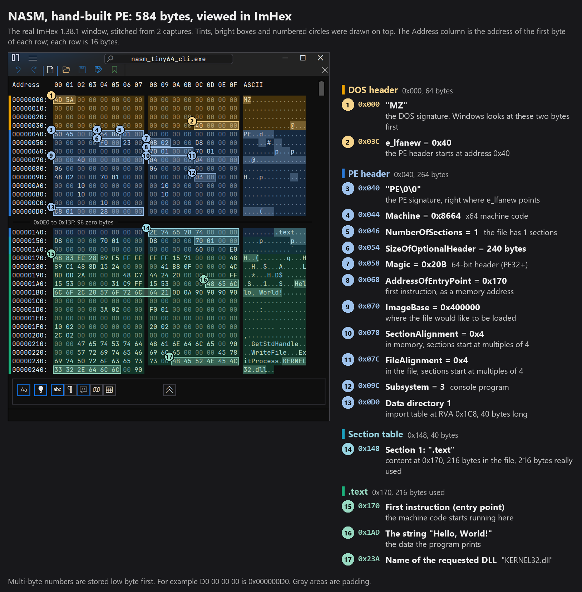

**584 bytes, hand-built PE in NASM.** `e_lfanew` is 0x40: the PE header follows the DOS header directly, with no DOS stub. The section table has a single row. The only section starts at 0x170, right after the section table, is 216 bytes long and holds the machine code, the "Hello, World!" string and the DLL name together. There is no padding between the parts.

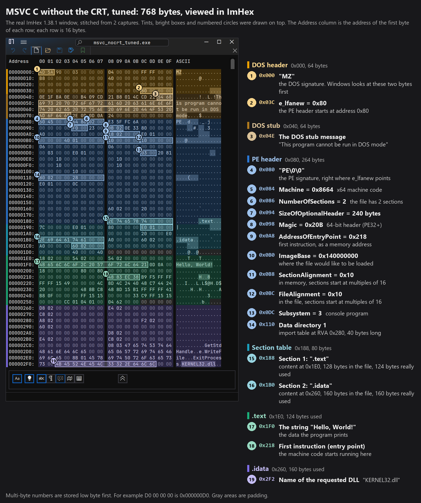

**768 bytes, MSVC C without the CRT, tuned.** The MSVC linker still inserts the DOS stub, so the PE header starts at 0x80. Both alignment fields (numbers 11 and 12) are 0x10, that is 16 bytes, so almost no padding is left between the parts. There are two sections: `.text`, 124 bytes, holding both the "Hello, World!" string and the machine code, and `.idata`, 160 bytes, holding the import table. Compared with the 584 byte build, the extra bytes are the DOS stub and the second section row.

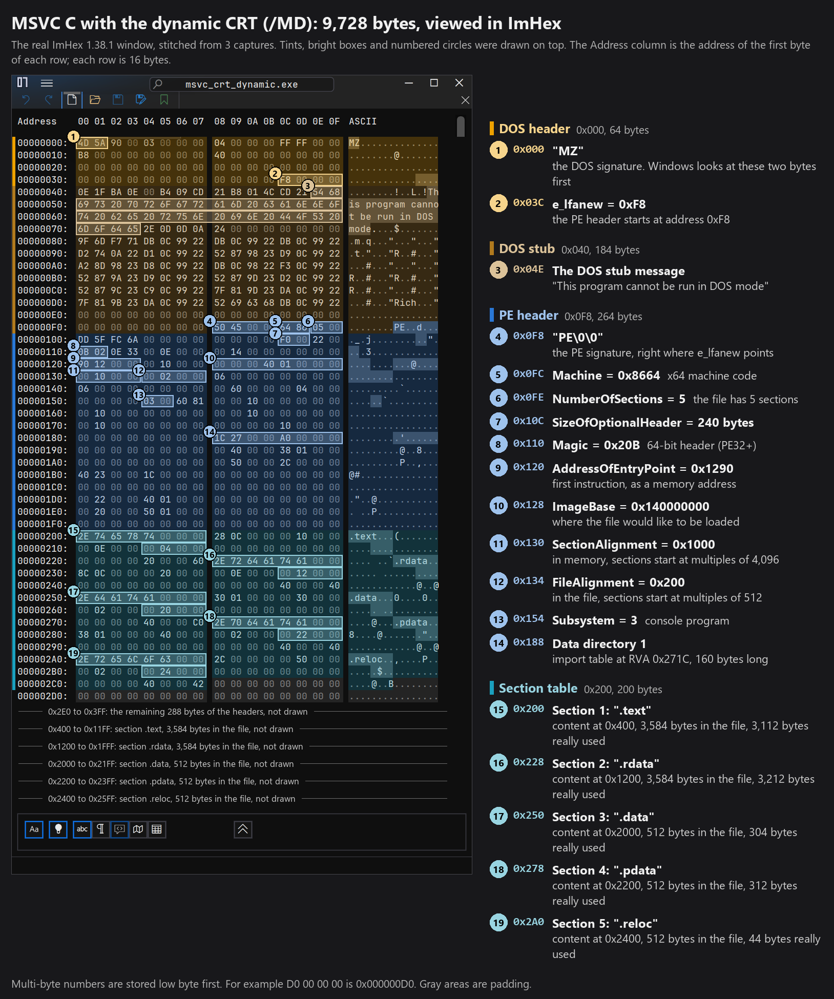

**9,728 bytes, MSVC C with the dynamic CRT.** The section table grows to five rows: compared with the 2,560 byte build, `.data` and `.reloc` are added. The `.text` section uses 3,112 bytes instead of 60. The entry point (number 9) no longer points to the start of the code section: Windows runs the CRT startup code first, and that code then calls `main`. File alignment is back to 512 bytes.

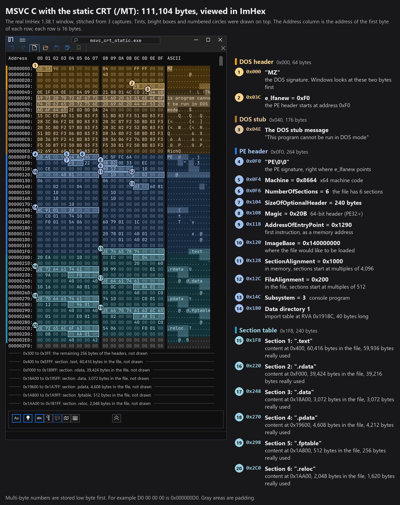

**111,104 bytes, MSVC C with the static CRT.** The headers are almost the same as in the dynamic CRT build; the difference is in the sizes written in the section table: `.text` 59,936 bytes and `.rdata` 39,216 bytes. That is the part of the CRT copied into the file. There is an extra `.fptable` section.

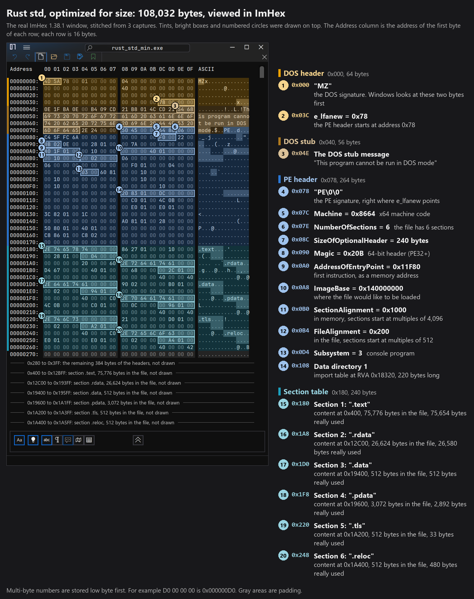

**108,032 bytes, Rust std.** The structure matches the static CRT build: six sections, `.text` 75,654 bytes. The difference is a `.tls` section, where the Rust standard library keeps per-thread data.

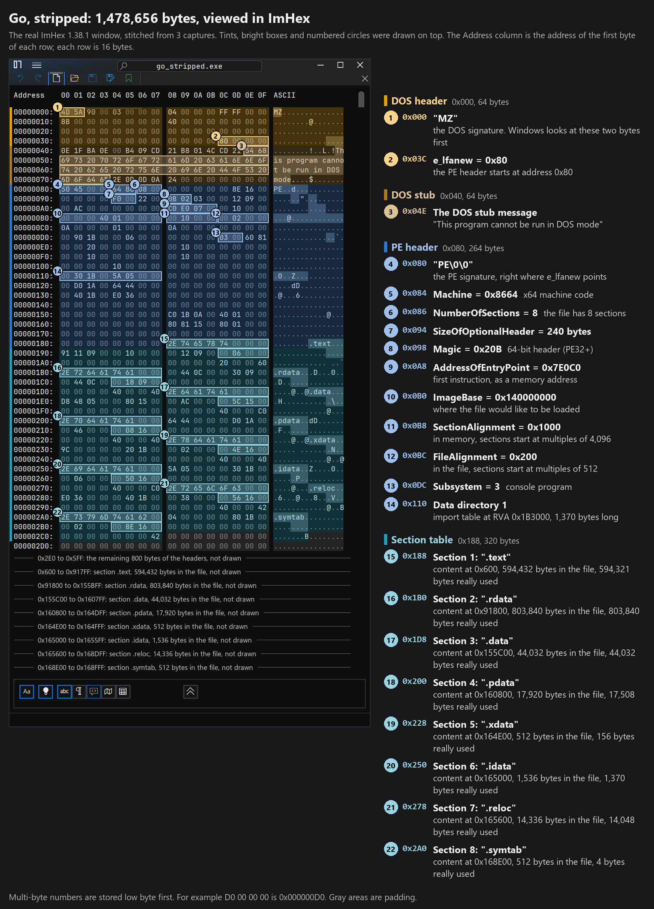

**1,478,656 bytes, Go.** The headers are only a few rows longer than in the builds above, because the section table has eight rows. The size is in the content: `.text` 594,321 bytes and `.rdata` 803,840 bytes. Go names its sections its own way, with `.xdata`, `.idata` and `.symtab`. The headers take up the file to 0x600 instead of 0x400.

Looking at all eight figures: the headers of the 1.4 MB file and of the 768 byte file are almost the same size. What makes a file big comes after the headers, in the sections the runtime brings along.

## 7. Why a small file does not mean less RAM

This is the easiest point to get wrong, so this section goes slowly, one idea at a time.

### 7.1. The disk and RAM are two different places

- **The disk** is where files are stored. "A 768 byte file" is a statement about the space it takes on disk
- **RAM** is the machine's workbench. For a program to run, it has to be laid out on the bench

Picture the exe file as a **recipe sheet**, and the process as **an actual cooking session**. Whether the recipe is short or long only affects the space it takes in the drawer. How many burners, pots and dishes you lay out depends on the dish you cook, not on how many lines the sheet has. A three-line recipe saying "have the restaurant deliver 20 dishes" still fills the whole table.

File size is the length of the recipe sheet. RAM is the amount of stuff laid out while cooking.

### 7.2. Every program pays a minimum charge, however small the file

Even for a program that does nothing, Windows still has to set up a kit for it before running the first instruction:

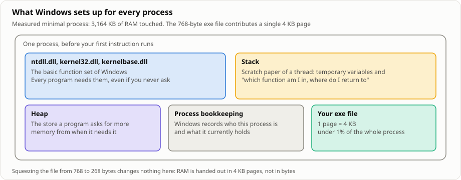

```
Windows sets up for EVERY process:

  ntdll.dll, kernel32.dll,      <- the basic Windows function set. Every program
  kernelbase.dll                   needs it, even if you do not ask
  stack                         <- the thread's scratch paper: where temporary variables go,
                                   and "which function am I in, where do I return to"
  heap                          <- a store the program draws more memory from when needed
  process bookkeeping           <- Windows records who this process is and what it has

  ... and only then your exe file: 1 page = 4 KB
```

Measurements on this machine for a minimal process [M-01]:

- Total RAM being touched: **3,164 KB**
- Of that, your 768 byte exe file takes **4 KB**, that is one page

So more than 99% of a Hello World program's RAM does not come from its file. Even if you squeeze the file from 768 down to 268 bytes, that 4 KB is still 4 KB, because RAM is handed out by the page and not by the byte.

### 7.3. Most of that minimum charge is shared stuff, not your own

Picture a public library. The books on the shelves are shared: if ten people read the same book, the library still needs only one copy. Notebooks are different: each person has their own.

Windows DLLs are like books on the shelf. The code of `kernel32.dll` has only **one copy** in the whole machine's RAM, and every program uses that copy. The stack, the heap and the variables, on the other hand, are each program's own notebook.

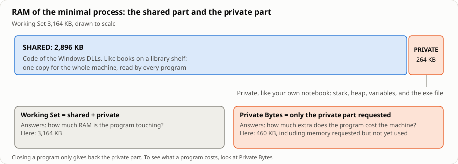

From this come two numbers that tools commonly show, and they answer two different questions:

| Name of the number | What it counts | Question it answers |
|---|---|---|
| **Working Set** | Shared stuff plus private stuff currently in RAM | "How much RAM is this program touching?" |
| **Private Bytes**, also called commit | Only the private stuff the program has asked for | "How much **extra** does this program cost the machine?" |

For the minimal process, Working Set is 3,164 KB but Private Bytes is only 460 KB. Private Bytes is larger than the 264 KB in the diagram because it also counts memory that has been asked for but not yet used.

When you close a program, the machine gets back only the private part. The books stay on the shelf for others to read. So to know how much your program costs, look at **Private Bytes**. This report uses Private Bytes as its main number.

### 7.4. Windows does not lay the whole file on the bench, only the pages that get used

Windows does not copy the whole exe file into RAM at startup. It only notes "this file is located here", and a page is read from disk only when it is touched. It is like turning only to the page of the book you need to read, not photocopying the whole book.

The consequence: a 1 MB file that only passes through 4 KB of code while running costs only 4 KB of RAM for code. This is the second reason a large file does not automatically cost RAM. Measured: the 584 byte NASM build and the 483,840 byte Zig build, more than 800 times larger, have nearly equal peak RAM, 3,212 KB and 3,280 KB [L-01].

### 7.5. So what makes RAM go up: every extra thing the program calls in

RAM goes up when the program pulls more stuff onto the bench. There are three kinds of stuff:

- **More DLLs.** Each DLL, when loaded, needs its own notebook inside your process: variables, tables, sometimes a whole heap. One DLL also usually drags in several others
- **More threads.** Each thread needs its own stack
- **Asking for memory itself.** The program calls `malloc`, `HeapAlloc`, or the language runtime reserves a large chunk at startup

The table below is the same program, with each row adding one thing. Read the Private Bytes column from top to bottom to see what each thing costs [M-01] [M-02] [M-05]. The numbers are measurements; the "Why it goes up" column is the author's explanation:

| What the program has | Private Bytes | Working Set | DLL count | Why it goes up |
|---|---|---|---|---|
| kernel32 only | 460 KB | 3,164 KB | 4 | the minimum charge |
| Add static CRT | 504 KB | 3,476 KB | 4 | the CRT sets up its own heap and tables |
| Add dynamic CRT | 636 KB | 3,772 KB | 6 | 2 more CRT DLLs |
| Add user32, no window created yet | 856 KB | 4,764 KB | 11 | the UI library drags in 7 DLLs |
| One window, input method disabled | 1,056 KB | 6,696 KB | 16 | a window needs drawing libraries, fonts |
| One window, default | 1,556 KB | 11,650 KB | 26 | the input method drags in 10 more DLLs and 2 threads |
| Accompanying console window, conhost.exe | 1,624 KB | 10,660 KB | not measured | a second process |

Two extreme examples, both printing one line of text:

- C build without CRT: 768 byte file, Private Bytes 420 KB
- Go build: 1,478,656 byte file, Private Bytes 12,252 KB. Go costs 29 times more not because the file is large, but because the Go runtime reserves memory and creates extra threads right at startup

And an example in the opposite direction: the Zig build using the standard library has a file 630 times larger than the C build without CRT (483,840 versus 768 bytes), but Private Bytes is only 528 KB versus 420 KB, because it drags in no significant extra DLLs.

### 7.6. Four ways to reduce RAM, drawn from the table above

1. **Request as few DLLs as possible.** This is the biggest lever. Going from 4 to 26 DLLs is going from 460 to 1,556 KB
2. **Create a window only when needed, and disable the input method if the program takes no typed text.** The input method, technical name IME, is the component that helps type Vietnamese or Japanese. Calling the function `ImmDisableIME` before creating the window saves 10 DLLs, 2 threads, 500 KB of Private Bytes and about 5 MB of Working Set
3. **Choose the windowed program type for a background tool.** The header has a slot named subsystem, recording whether the program is the console type or the windowed type. A console-type program that opens its own black window drags along a second process, `conhost.exe`, costing an extra 10.7 MB of Working Set
4. **Do not create threads or ask for memory before you need them.** Each thread is a stack, each request adds Private Bytes

File size does not appear in these four ways. Shrinking the file and reducing RAM are two separate jobs that must be done separately and measured separately. The only thing they have in common is dropping the runtime library: that both shrinks the file the most and removes DLLs.

## 8. Common misconceptions

> **"The smaller the file, the less RAM."** Wrong. RAM is decided by the number of DLLs, the number of threads and the amount of memory the program asks for. The 584 B and 483,840 B builds use nearly the same RAM. So squeezing the file from 768 down to 584 bytes saves not a single byte of RAM.

> **"With the dynamic CRT the program is lighter because the file is only 9.7 KB."** Half wrong. The file is smaller than the static CRT build, but RAM is higher: 636 KB versus 504 KB commit, because extra DLLs must be loaded. The CRT does not disappear, it just moves to another file. A further consequence: on a machine that does not already have that DLL the program will not run, like the sample tested on the clean virtual machine.

> **"`e_lfanew` is a complicated structure."** Wrong. It is just a 4 byte number at offset `0x3C` saying where the PE header starts. The whole 268 byte trick is just setting that number to 4.

> **"The Memory figure in Task Manager is the RAM my program eats."** Not quite. Most of a small program's Working Set is shared pages that were already in RAM because other programs use them too. Closing your program does not give that part back.

> **"The Optional header can be left out."** Wrong. The name comes from the object file format. For an exe file this block is mandatory and is the longest one in the header.

## 9. Trade-offs: how small before you stop

Each shrinking step removes something Windows or the author used to rely on:

- Drop the CRT: you lose `printf`, `malloc`, and must call Windows functions directly. No effect on compatibility
- Reduce alignment to 16: the linker warns LNK4108. It has run on the three Windows 11 releases tested, but Microsoft makes no commitment
- Drop `.reloc`: you lose ASLR, and the file is rejected on machines with the mandatory ASLR policy enabled
- No CFG table: rejected on machines with Strict CFG enabled, error code 1657. CFG is a mechanism that checks the targets of indirect calls
- Overlapped headers: the file cannot be modified or debugged with ordinary tools

So the report recommends stopping at C without CRT. For real programs, the project additionally keeps a standard-alignment build with ASLR: Pulsar mini is 9,728 B versus 7,984 B for the minimal build. The 1,744 byte difference buys the ability to run on machines with protection policies enabled.

## 10. One sentence

An exe file is a 264 byte table of contents plus compartments of code and data; Windows only needs a correct table of contents and the DLLs to be present, so the file gets smaller when you drop the runtime library, spare compartments and padding bytes, while RAM only goes down when the program loads fewer DLLs and creates fewer threads and fewer windows.

<a id="s01"></a>

# Summary: C without CRT gives a 768 byte hello and a real 7,984 byte widget

> **TL;DR** For a small, light Windows exe file: write it in **C, drop the runtime library (CRT) and call Windows functions directly**. A Hello World built this way is **768 bytes** long, is not flagged by antivirus, and uses 0.42 MB of private RAM. The smallest file that Windows 11 x64 still agrees to run is **268 bytes**; the 20, 97, 133 and 252 byte records no longer run. A small file does not mean less RAM: RAM is decided by the number of DLLs and windows. Applied to real tools: the reduced version of Pulsar is **7,984 bytes** long and uses **1.25 MiB** of private RAM, versus 3.95 MB and 13.93 MiB for the original.

**Reading order.** Not yet familiar with how Windows runs an exe file: read [Part 0](#s00) first; it explains every term used here. Only need the conclusions: read the question table and the recommendation section right below. Want to do it yourself: [Part 3](#s03). Want to understand why: [Part 2](#s02) on languages, [Part 4](#s04) on the 268 byte limit, [Part 5](#s05) on RAM and CPU, [Part 6](#s06) on compression and antivirus. The two reduced tools are in [Part 7](#s07); methodology and limitations in [Part 8](#s08).

**Scope of the measurements.** Every measurement was taken on one machine, Windows 11 Pro build 26300 x64. The Hello World and tiny PE figures were measured on 2026-11-17; the two mini builds and the two original apps were measured on 2026-11-18 from a fresh start. Newer tables use KiB/MiB.

**Test status of the two mini builds.** Details in [Part 7](#s07); the four build steps are labelled P1 to P4. Pulsar mini passes step P2: 7,984 B, Private Bytes near second 60 with a median of 1.25 MiB, CPU wakeups measured with ETW at 3.567 / 4.150 / 2.600 per second over three runs. Battery mini is 11,760 B long, the command-line build 4,448 B; both read 28%, matching the original before and after unplugging and replugging the receiver. Step P1 checked 3 Explorer restarts (slowest 3.969 seconds), four DPI and theme combinations, one fullscreen browser session and one sleep-and-wake cycle. The desktop screenshot of the v1.3 build is not yet confirmed. Mini results, P1 v1.2, P2 v1.3.

**How to read the labels.** The labels are the same English labels used in the original notes. An evidence-type label says where a number comes from:

| Label | Meaning |
|---|---|
| Measured | Measured directly on this machine, with a raw data file attached |
| Official | Taken from the publisher's official documentation, for example Microsoft Learn |
| Inference | Reasoned from the measurements and documentation, with no measurement of its own |
| Forecast | A projection for work not yet done |

The "Confidence" column says how certain the answer is: **High** means measured or officially sourced with no counter-evidence; **Medium** means there is evidence but only on one machine or one version so far, or it rests partly on inference; **Low** means mostly conjecture.

## Answers to each question

| Question | Short answer | Confidence | Details |
|---|---|---|---|
| Which language gives the smallest exe? | C without CRT (768 B) or NASM (584 B). Rust `no_std` 848 B, Zig 3 KB, Go 1.5 MB | High [Measured] | [Part 2](#s02) |
| The floor of the PE format on Win11 x64? | 268 bytes, for both x64 and x86. The 97, 133, 252 byte records no longer run | High [Measured] | [Part 4](#s04) |
| How do you write it? | Write your own entry point, call the Win32 API directly, drop default libraries, merge sections, reduce alignment | High [Measured] | [Part 3](#s03) |
| What decides RAM/CPU? | The DLLs loaded and whether a window is created. With a blocking wait, idle CPU is 0 | High [Measured] | [Part 5](#s05) |
| Is compressing the exe worth it? | No, for this goal. Crinkler gets deleted by AV and its default mode costs 500 MB of RAM; UPX is useless below a few KB | High | [Part 6](#s06) |
| The 20 byte gnostice file? | It is a 16-bit DOS program and does not run on 64-bit Windows | High [Measured] | [Part 4](#s04) |
| Risks? | AV false positives on compressed exes; a Windows update may tighten the loader; a taskbar child window is fragile | Medium | [Part 6](#s06) |
| Anything new in the last 12 months? | There are compiler releases newer than the ones measured; the toolchain comparison branch cross-checked MSVC, Rust, GCC, LLVM, NASM, Zig, Nim, Odin and Go. Not everything was re-measured with the new releases | High for published versions | Toolchain notes |
| The two target tools? | Pulsar from a fresh start: 13.93 MiB Private Bytes, median of 3 runs. Both minis now have C code without CRT; see the acceptance gates and the measurements per exact binary | High / Medium | [Part 7](#s07) |
| Does a small size mean less RAM? | No. A 2.5 KB exe and a 1 MB exe use exactly the same RAM | High [Measured] | [Part 5](#s05) |
| What would make the answers wrong? | Measuring the wrong RAM metric, measuring CPU with too coarse a tool, trusting self-reported numbers | High | [Part 5](#s05), [Part 8](#s08) |

The first five questions are from the original request. The last six were added by the author during the research, because their answers affect the conclusions.

## Recommendation for the decision

**Use C without CRT, built with MSVC (or MinGW gcc), GUI subsystem for a background tool.** Criteria used and their weights: size 25%, not flagged by AV 20%, maintainability 20%, RAM 15%, surviving Windows updates 10%, debugging tools 10%. The full matrix, with adjustable weights, is in the site's "Decision matrix" view.

Tiers, so you can see the price of each level:

| Tier | Approach | CLI hello | Caught by Defender | Private RAM |
|---|---|---|---|---|
| Byte golf within the test set | Hand-written PE, overlapped headers | 268 B (returns an exit code only) | Not flagged locally so far | PeakPagefileUsage 424 KiB, no resident figure |
| Byte golf with compression | Crinkler 3.0b, x86 | 355 B | **Yes, deleted** | not measured (default mode: 500 MB) |
| **Clean, smallest** | **NASM, standard PE with 1 section** | **584 B** | **No** | **0.41 MB** |
| **Clean, maintainable (recommended)** | **C without CRT + linker flags** | **768 B** | **No** | **0.42 MB** |
| Conventional | C with CRT, Rust std, Go | 9.7 KB to 2.2 MB | No | 0.6 to 12 MB |

Why C rather than assembly: in the measured hello the difference is 184 bytes with similar RAM, while C is more convenient for writing Win32. There is no equivalent assembly widget yet, so the difference for a real app has not been quantified.

For a background tool (like the two tools you picked), add three rules from the RAM/CPU measurements:

1. Use the GUI subsystem, not console: this avoids the conhost.exe process costing an extra 10.7 MB of Working Set
2. Wait with `GetMessage` plus one 1 second `SetTimer`, no polling: idle CPU near 0
3. Call `ImmDisableIME` before creating the window if no text input is needed: saves 5.0 MB of Working Set and leaves 1 thread

## Key numbers

| Number | Value | Scope | Type | Source |
|---|---|---|---|---|
| PE size floor | 268 bytes | x64 and x86 on Win11 26300 | [Measured] | [R1-M1] [R1-M3] |
| Smallest clean CLI hello | 584 bytes | NASM, x64 | [Measured] | [L-01] |
| CLI hello in C without CRT | 768 bytes | MSVC 14.51 | [Measured] | [L-01] |
| CLI hello in C with static CRT | 111,104 bytes | MSVC `/MT` | [Measured] | [L-01] |
| Default Go hello | 2,248,192 bytes | Go, x64 | [Measured] | [L-01] |
| Private RAM floor of a process | 460 KB commit | kernel32 only, 1 thread | [Measured] | [M-01] |
| Working Set of that process | 3,164 KB | 2,896 KB are shared pages | [Measured] | [M-01] |
| Adding one window | +0.9 MB commit, +6 to 8 MB WS | compared with no user32 | [Measured] | [M-01] [M-02] |
| conhost.exe for a new console | 10.7 MB WS, 1.6 MB commit | `CREATE_NEW_CONSOLE` | [Measured] | [M-05] |
| Idle CPU, blocking wait | 0 cycles | 20 seconds | [Measured] | [M-06] |
| Idle CPU, `Sleep(1)` loop | 1.3 million cycles per second | about 99 wakeups per second | [Measured] | [M-06] |
| Builds caught by Defender | 2 of 29 | only the 2 Crinkler builds | [Measured] | [L-02] [L-03] |
| Pulsar 0.8.0 private RAM | 13.93 MiB | installed binary 3,950,080 B, fresh start, 3 runs on 2026-11-18 | [Measured] | `raw/r4-fresh-cycles-20261118.jsonl`, label installed-fresh |
| Wireless Battery 1.0.4 private RAM | 3.16 MiB | binary 483,840 B, 3 fresh-start runs on 2026-11-18 | [Measured] | same log, label wdbm-fresh |

## Corrections to the initial facts

- **"The smallest Hello World is 20 bytes" (the gnostice article) does not apply to today's Windows.** That is a 16-bit DOS .COM file created with DEBUG in 2011. Rebuilt at exactly 20 bytes and run on this machine: Windows rejects it with error 216. 64-bit Windows does not run 16-bit code [R1-01] [R1-M11] [R1-23]. The correct equivalent figure is 268 bytes. A byte-by-byte diagram of that file and the exact error messages are in [Part 4](#s04), in the correction section
- **"Assembly or C" is half right.** Both give results under 1 KB, but only if the CRT is dropped. C with the static CRT comes out at 111 KB, meaning the language matters less than whether a runtime is pulled in. Rust `no_std` also reaches 848 bytes [L-01]
- **The commonly quoted 97 byte, 133 byte and 252 byte figures are outdated.** No file under 268 bytes runs on Windows 11 x64 [R1-M1] [R1-M3]
- **Do not conclude that a self-reported RAM figure is wrong just from a different metric.** Pulsar from a fresh start uses only a median of 13.93 MiB of private commit; the 33.55 MiB mark was an instance that had run for 8 days. Wireless Battery has about 2 MiB of Private Working Set in a fresh run, so its self-reported "about 2 MB" may be consistent with that metric [Inference]. The measured release exe is still 483,840 B. See Part 7 for the distinction between commit and resident RAM.
- **Pulsar being "Rust + Slint" is true only of the Settings window.** The resident process draws with Direct2D and DirectWrite [R4-01]

## Assumptions

- The target platform is x64 on this machine's Windows 11; x86 is for comparison only
- "RAM" is reported primarily as Private Bytes (commit), with Working Set alongside; the reason is in [Part 5](#s05)
- The mini builds are functional subsets for personal use; the code and binaries are in `poc/mini/`. They are not treated as full replacements for the original apps' GPU/disk/temperature features, UI and every battery driver
- AV warnings are accepted in the byte golf tier, but the main recommendation is the clean tier
- One physical machine, build 26300. The loader was additionally tested on virtual machines running 24H2 build 26100.1742 and 25H2 build 26200.6584, with 48/48 cells identical. [Virtual machine matrix](raw/windows-cross-build-matrix.md)

<a id="s02"></a>

# The language matters less than the runtime: drop the CRT and C, Rust and assembly all land under 1 KB

> **TL;DR** We measured 27 Hello World builds from 9 toolchains: every build that drops the runtime and reduces alignment lands between 584 and 864 bytes, whether it is NASM, C or Rust; keeping the 512-byte alignment gives 2,048 to 3,072 bytes. In the v1.0 group, builds that keep a runtime start at 9.7 KB, and Go reaches 2.2 MB. Choose C without the CRT because it is close to the smallest and the easiest to maintain.

## The measured size ladder

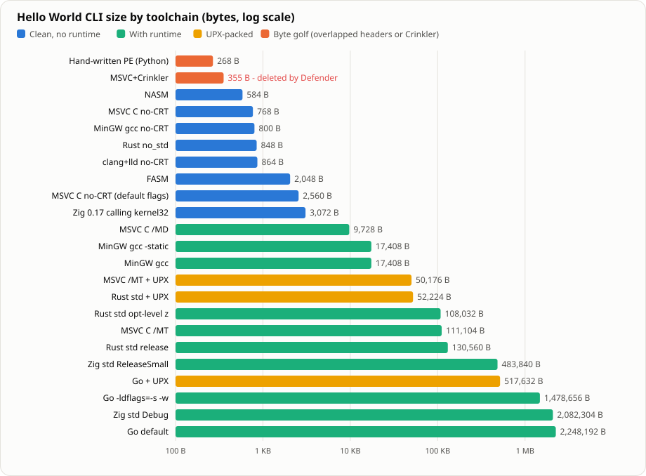

*Source: Lead's measurements, `raw/hello-measure.jsonl` [L-01]; 268 bytes from [R1-M1]; Crinkler from [R1-M12]*

The chart uses a log scale because the gap between the smallest and the largest build is more than 8,000 times. There are three clear clusters:

- **Under 1 KB**: builds with no runtime. NASM 584 B, MSVC C 768 B, gcc C 800 B, Rust `no_std` 848 B, clang 864 B
- **2 to 3 KB**: the same code, but the linker keeps the default 512-byte alignment (FASM 2,048 B, MSVC with untuned flags 2,560 B, Zig 3,072 B)
- **9.7 KB and up**: a runtime is included. MSVC dynamic CRT 9,728 B, gcc 17,408 B, Rust std 108,032 B, MSVC static CRT 111,104 B, Zig std 483,840 B, Go 1.48 to 2.25 MB

The CRT (C Runtime) is C's runtime library: startup code, `printf`, `malloc`. Hello World needs only two Windows functions (`GetStdHandle`, `WriteFile`), so the whole CRT is dead weight.

The two GCC configurations with and without `-static` both produce exactly the same 17,408 B content, with the same SHA-256; both still import the UCRT API set. So the 27 builds here are measured build configurations/commands; this does not claim 27 unique binaries, or that every build named static embeds the UCRT. See the build audit.

## Option matrix

| Toolchain | Version used | Smallest CLI | Smallest GUI | License | Maintainability | Fit |
|---|---|---|---|---|---|---|
| NASM, hand-built PE | 3.01 | 584 B | 588 B | BSD 2-clause | Low | High if you need the absolute smallest in the clean class |
| MSVC C without CRT | 14.51 (VS 18) | 768 B | 784 B | Commercial, Community edition is free | High | **Highest** |
| MinGW-w64 gcc without CRT | gcc 16.1 | 800 B | 816 B | GPL (compiler), runtime has an exception | High | High |
| Rust `no_std` | 1.99.1 | 848 B | not measured | MIT or Apache 2.0 | Medium | High if you already use Rust |
| clang + lld | 22.1.7 | 864 B | not measured | Apache 2.0 with LLVM exception | High | High |
| FASM | 1.73.35 | 2,048 B | 2,048 B | Its own BSD-like license with additional clauses | Low | Medium: the measured PE sample uses 512-byte alignment |
| Zig calling kernel32 directly | 0.17.1 | 3,072 B | not measured | MIT | Medium | Medium: the standard library API changes with every release |
| C with CRT | MSVC, gcc | 9,728 B | 9,728 B | as above | Highest | Low for this goal |
| Rust std | 1.99.1 | 108,032 B | not measured | MIT or Apache 2.0 | High | Low |
| Go | version on this machine | 1,478,656 B | not measured | BSD 3-clause | High | Very low: 12 MB of private RAM |
| Crinkler (compressed, x86) | 3.0b | 355 B | 351 B | Zlib | Low | Low: deleted by AV; the default mode costs 500 MB of RAM |

Every size is [Measured] [L-01]. The "Maintainability" and "Fit" columns are the author's assessment [Inference]. These are the versions **that were measured**, not a list of the latest releases. Source check on 2026-11-18: NASM 3.02, GCC 16.2, LLVM 23.1.6 and Rust 1.100.0 have been released. Results from the older compilers are not attributed to these newer versions. The table of release dates, license scope and languages not yet measured is in the toolchain notes.

## Six additional toolchains on the same workload

MASM with default alignment gives 2,560 B. With sections merged and alignment 16, MASM exactly matches C without the CRT at 768 B. TinyCC 2,048 B, Free Pascal 45,568 B, Nim after strip 77,312 B, Odin 126,976 B and NativeAOT 759,296 B. Each x64 build ran 3/3, printed the correct 15 ASCII bytes with CRLF and exited 0. These are the measured configurations of each tool. Results and build steps.

## Why C without the CRT wins

- **Size**: 768 B, only 184 bytes more than the assembly build. For a real tool of a few KB, that difference is under 5%
- **RAM**: identical to assembly. Peak Working Set 3,196 KB versus 3,212 KB [L-01]
- **Effort**: the source is ordinary C; the only differences are that you write your own startup function and do not use `printf` or `malloc`
- **Local AV result**: the scanned C builds were not flagged by Defender in the measurement session [L-02]

Rust `no_std` is worth considering if you like Rust: the hello sample here is 848 B, with the same startup RAM. This sample declares its own FFI and writes a panic handler; declaring the API by hand is not required, because [Microsoft's windows-sys](https://github.com/microsoft/windows-rs/tree/master/crates/libs/sys) works with no_std. An equivalent Rust widget has not been measured for a direct comparison with C.

## Rejected options

- **Go**: the measured builds still pull in the runtime, giving a file of about 1.5 MB and about 12 MB of private RAM, which does not fit this project's thresholds [L-01]. This is a conclusion about the Go build path that was tried, not about every compiler or every way of using the Go language
- **Zig with the standard library**: 483,840 B in `ReleaseSmall` mode. The build that calls kernel32 directly is 3 KB, but Zig's standard library API changed heavily between 0.15 and 0.17, and Hello World code written for 0.15 no longer compiles
- **FASM**: convenient because it emits a PE itself with no linker. The 2 KB figure is the measured `format PE` sample; it is not a general limit, since FASM can also emit a raw binary and build the header by hand. See [the author's formatter code](https://raw.githubusercontent.com/tgrysztar/fasm/master/SOURCE/FORMATS.INC).
- **.NET NativeAOT**: not measured, so it is not ranked by size with a number. AOT removes the need for a JIT at run time but still puts the required runtime parts into the program. There is no evidence yet for it to replace the C choice in this project. See the [NativeAOT documentation](https://learn.microsoft.com/en-us/dotnet/core/deploying/native-aot/).
- **Crinkler**: see [Part 6](#s06)

## Counter-evidence

Two community discussions about Rust and Zig binary size. These are the posters' self-reported experience:

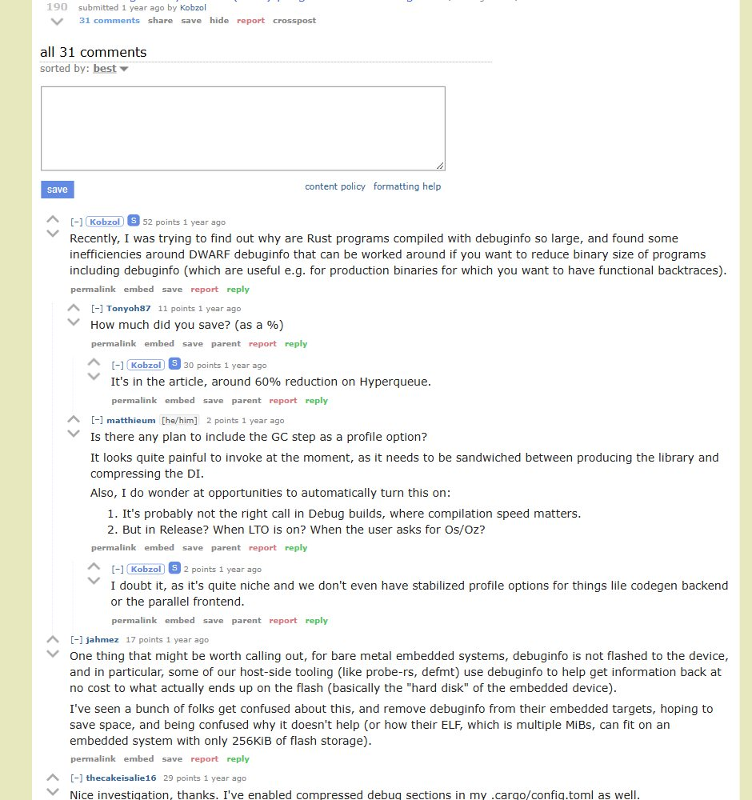

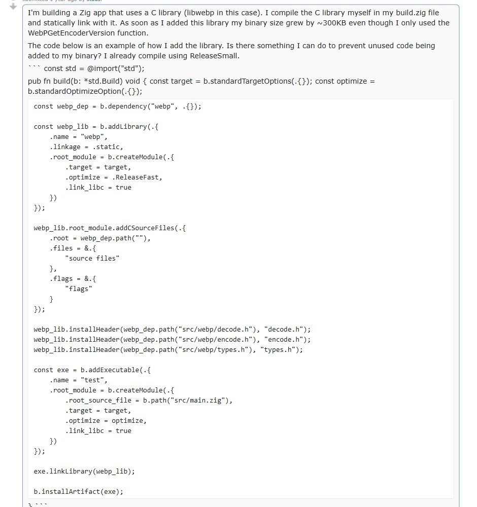

- The hello builds support a small gap: NASM and C without the CRT differ by 184 bytes [L-01]. The initial hypothesis was about real apps; there is no assembly widget with the same features yet to confirm that part
- A Hacker News comment argues that setting flags is enough: "You can get a sub 20kb executable with C in MSVC and no weird tricks" (ntstatusquo, 2026-08-25) [R1-10]. Our measurements show you can go much further: 768 bytes
- The toolchain comparison branch was extended on 2026-11-18, cross-checking mechanisms, build flags and published versions. There is still no independent benchmark with the same source, OS and linker flags to replace the local measurements. MASM, TinyCC, Odin, Nim, Free Pascal and NativeAOT have still not been built in this comparison set.

<a id="s03"></a>

# How to write it: your own entry point, direct Win32 calls, and six linker flags that take 111 KB down to 768 bytes

> **TL;DR** Three steps: (1) replace `main` with your own startup function and call the Windows API directly, (2) tell the linker to drop the default libraries, (3) merge sections and reduce alignment. Each step is measurable: 111,104 B down to 9,728 B down to 2,560 B down to 768 B. All the code and build commands are ready in `poc/hello/`.

The terms CRT, entry point, section and alignment are explained in [Part 0](#s00), sections 2 and 4.

## The path of a build

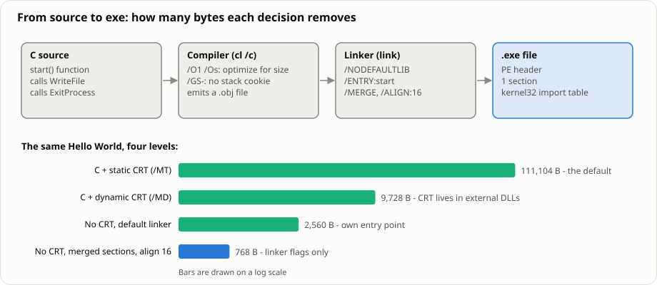

*Source: `poc/hello/build.ps1`, measurements [L-01]*

Read the diagram from left to right. The bottom row shows the same program that prints "Hello, World!" shrinking through four levels. The last level does not change a single line of code compared with the third; only the linker flags differ.

## Step 1: source code without the CRT

The complete console program, file `poc/hello/c_nocrt.c`:

```c
#include <windows.h>
void __stdcall start(void) {
    static const char msg[] = "Hello, World!\r\n";
    DWORD n;
    WriteFile(GetStdHandle(STD_OUTPUT_HANDLE), msg, sizeof msg - 1, &n, NULL);
    ExitProcess(0);
}
```

Three differences from ordinary C:

- **The startup function is named `start`, not `main`.** Windows calls this function directly. Nobody prepares `argc` and `argv` for you; if you need arguments, call `GetCommandLineW`
- **You must call `ExitProcess` yourself.** Returning from the startup function also exits, but an explicit call is more reliable when other threads exist
- **There is no `printf`, `malloc` or `memcpy`.** Use `WriteFile`, `wsprintfW` (user32) and `HeapAlloc` instead. The compiler sometimes generates calls to `memset` or `memcpy` on its own; when that happens, write those two functions yourself

The GUI build (`gui_nocrt.c`) differs only in the `MessageBoxA` call and also needs user32.

## Steps 2 and 3: compiler and linker flags

The MSVC commands used to reach 768 bytes:

```bat
cl /nologo /O1 /Os /GS- /Gs9999999 /Oi- /c c_nocrt.c
link /NODEFAULTLIB /ENTRY:start /SUBSYSTEM:CONSOLE ^
     /DYNAMICBASE:NO /FIXED /MANIFEST:NO /DEBUG:NONE ^
     /EMITTOOLVERSIONINFO:NO /NOCOFFGRPINFO ^
     /MERGE:.rdata=.text /MERGE:.pdata=.text ^
     /ALIGN:16 /FILEALIGN:16 /OPT:REF /OPT:ICF /SECTION:.text,ERW ^
     c_nocrt.obj kernel32.lib
```

| Flag | Effect | Why it is needed |
|---|---|---|
| `/GS-` | Turns off the cookie-based stack overflow check | The cookie needs CRT code |
| `/Gs9999999` | Raises the stack probe insertion threshold very high | Used only in the small-stack hello sample; do not apply it blindly to a widget |
| `/NODEFAULTLIB` | Does not link the default libraries | This is the step that drops the CRT |
| `/ENTRY:start` | Names the startup function | There is no `mainCRTStartup` any more |
| `/MERGE:.rdata=.text` | Merges the read-only data section into the code section | Each section costs a 40-byte entry plus alignment padding |
| `/ALIGN:16 /FILEALIGN:16` | Reduces section alignment from 4,096 and 512 bytes to 16 | This is the flag that saves the most: 2,560 B down to 768 B |
| `/DYNAMICBASE:NO /FIXED` | The first removes the ASLR opt-in; the second removes relocations | Two different effects, not synonyms |
| `/MANIFEST:NO /DEBUG:NONE` | No embedded manifest, no debug information | Saves a few hundred bytes |
| `/EMITTOOLVERSIONINFO:NO` | Removes the tool version information block from the header | Saves a few dozen bytes |

The linker emits warning LNK4108 when `/ALIGN:16` is used ("image may not run"). On this machine every build runs [L-01], but this is outside the official documentation: Microsoft's documentation says file alignment should be at least 512 bytes [R1-05]. See the risks in [Part 6](#s06).

The equivalent command for MinGW gcc (gives 800 bytes):

```bash
gcc -Os -s -nostdlib -fno-asynchronous-unwind-tables -fno-ident -e start \
  -Wl,--gc-sections,--file-alignment=16,--section-alignment=16,--disable-dynamicbase,--disable-reloc-section,--no-insert-timestamp \
  c_nocrt.c -lkernel32 -o hello.exe
```

The Clang + LLD command for **the MSYS2 GNU driver** used in the hello set:

```powershell
clang -Os -s -nostdlib -fuse-ld=lld -fno-asynchronous-unwind-tables `
  '-Wl,-e,start' '-Wl,--file-alignment=16,--section-alignment=16' `
  c_nocrt.c -lkernel32 -o hello.exe
```

`-fuse-ld=lld` selects the linker, `-Wl,` passes flags to the linker, `-nostdlib` drops the startup code and default libraries. `clang-cl`/`lld-link` is a different path that uses MSVC syntax. See [LLD Windows support](https://lld.llvm.org/windows_support.html).

`/Gs` and `/GS` are two different flags. Raising the `/Gs` threshold can let a large stack frame jump over the guard page; the mini build keeps the default threshold. The compiler can still generate `memcpy`/`memset`, so the mini build has its own helpers in `poc/mini/runtime.c`. The object that contains the helpers is compiled without `/GL`, while the application objects use LTO. See the [stack probe documentation](https://learn.microsoft.com/en-us/cpp/build/reference/gs-control-stack-checking-calls).

For Rust, the linker flags are set in `build.rs` and the code uses `#![no_std]`, `#![no_main]`; see `poc/hello/rust_nostd/`.

Importing APIs by name is the default choice. Ordinal imports and the PEB walk were analyzed at the mechanism level in the toolchain notes, but no comparison build was made. The PEB is an internal structure that may change; finding exports yourself also means handling forwarded exports. There is no measurement showing that this path saves bytes for this widget.

## Going further down to 584 bytes: building the PE file by hand with NASM

PE (Portable Executable) is the .exe file format. Instead of letting a linker build it, the file `poc/hello/tiny64.asm` writes every header field directly with `db` and `dd` directives, and `nasm -f bin` emits the exe. The layout is still a standard PE: headers do not overlap, there is one section, and there is a real import table. The only differences from the linker build are the 4-byte alignment and the absence of any spare bytes.

Result: CLI 584 B, GUI 588 B. This is the smallest build that is still "clean" in the sense of: normal structure, no compression, no Defender detection [L-02].

## Minimal GUI: MessageBox versus a real window


- `MessageBoxA` is the smallest GUI: one call, 784 B in C. It suits a one-off notification
- A real window needs `RegisterClassW`, `CreateWindowExW` and a `GetMessage` loop. The test build in the RAM and CPU measurement branch (C without the CRT, alignment not yet reduced) is 3,072 B [M-01]
- A tool that docks into the taskbar also needs a manifest declaring Windows 10 support and PerMonitorV2 DPI awareness; otherwise the transparent child window cannot be created. The manifest costs a few hundred more bytes [R4-01]. Details in [Part 7](#s07)

## Check it again on your machine

```powershell
pwsh -File poc\hello\build.ps1        # builds all 29 variants, prints the size table
pwsh -File build\measure-hello.ps1    # measures RAM and CPU, writes raw\hello-measure.jsonl
```

You need MSVC, MSYS2 ucrt64 (gcc, clang, nasm, upx), Rust and Go; FASM, Zig and Crinkler are already in `tools/`.

<a id="s04"></a>

# The 268-byte floor: Windows 11 x64 rejects every smaller exe, including the old records

> **TL;DR** Windows checks the file size before it creates a process: the file must be at least 268 bytes long. This number holds for both x64 and x86 and was re-measured on this machine. The 97, 133 and 252-byte records and the 20-byte DOS file all fail to run. There has been no new record in the past 12 months.

## Why exactly 268 bytes

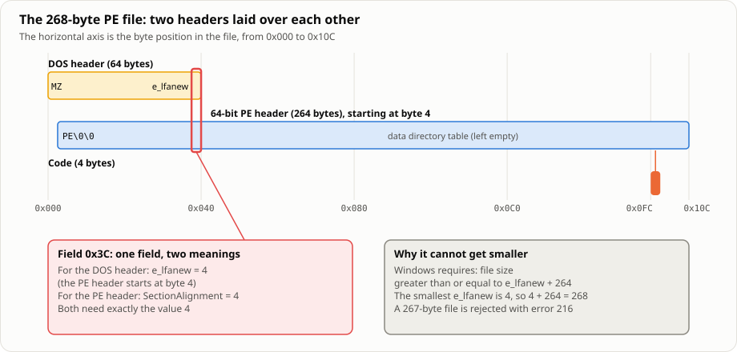

*Source: R1's experiments, `scratch/01/` [R1-M1] [R1-M2]; field values taken from a hexdump of the file that ran*

The measured rule: **the file size must be greater than or equal to `e_lfanew` + 264**.

- `e_lfanew` is the field at offset 0x3C that says where the PE header starts. The smallest valid value is 4
- 264 is the size of the 64-bit PE header structure
- 4 + 264 = 268

The diagram shows the trick that makes this possible: the PE header is placed right at offset 4, on top of the rest of the DOS header. The cell at 0x3C is therefore both `e_lfanew` (value 4) and the PE header's `SectionAlignment` field (which also needs the value 4). One cell, two meanings.

Evidence [Measured] (High):

- The 268-byte file runs and returns exit code 42. Truncated to 267, 266, 264 ... 100 bytes: all are rejected with error 216, before a process is created [R1-M1]
- With the PE header at the standard position 0x40 (no overlap): 327 bytes is rejected, 328 bytes runs. 328 = 0x40 + 264 [R1-M2]
- x86 also needs 268 bytes, not 252 as many sources state. Windows x64 checks every file against the 64-bit header size [R1-M3]

Microsoft does not state this number in its documentation [R1-05]. A community note matches the measurement: "it must be 268 bytes or else windows will refuse to load it, regardless of the contents" (rcx, 2019) [R1-06].

## What Windows checks before it runs an exe

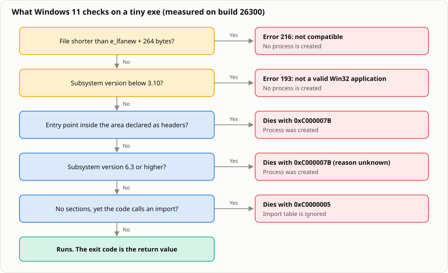

*Source: [R1-M1] to [R1-M8], measured on Windows 11 build 26300*

Read from top to bottom. The first two steps happen before a process exists (errors 216, 193). The later steps happen once the process has been created, and it dies immediately with the corresponding error code. Two rules worth remembering:

- The point where execution starts must not lie in the region declared as headers. This rule dates from Windows 8 [R1-08]
- If the file has no section, the import table is ignored. Calling an API the usual way needs at least one section [R1-M8]

## How useful 268 bytes is

The 268-byte file by ayaka14732 (shows a MessageBox, made in 2019 for Windows 10) still runs on Windows 11 26300 [R1-M9] [R1-02]. But to squeeze an API call into 268 bytes, the author had to split the code into fragments and hide them in unused header cells. That is a jigsaw puzzle, not a way of writing software.

For a program that does real work, every functional byte has to be added after the 268 bytes. The 584-byte NASM build in [Part 3](#s03) is the balance point: normal structure, readable, editable.

## The historical ladder

| Size | What it is | Runs on Win11 x64? | Source |
|---|---|---|---|
| 20 B | DOS .COM (gnostice article, 2011) | No, error 216 | [R1-01] [R1-M11] |
| 97 B | Tiny PE for Windows XP (Sotirov, around 2006) | No | [R1-03] [R1-M3] |
| 133 B | Tiny PE for Windows 2000 | No | [R1-03] [R1-M3] |
| 252 B | Tiny PE x86 for 32-bit Vista and 7 | No | [R1-04] [R1-M3] |
| **268 B** | Current floor, x64 and x86 | **Yes** | [R1-M1] [R1-M3] [R1-M9] |
| 328 B | Minimum without overlapping headers | Yes | [R1-M2] |
| 584 B | NASM, standard PE, prints Hello World | Yes | [L-01] |

## Correction: the 20-byte gnostice file

The claim "the smallest Hello World is 20 bytes" is true, but for a different operating system. This section explains what that file is and what happens when you run it on Windows 11.

### What the file is

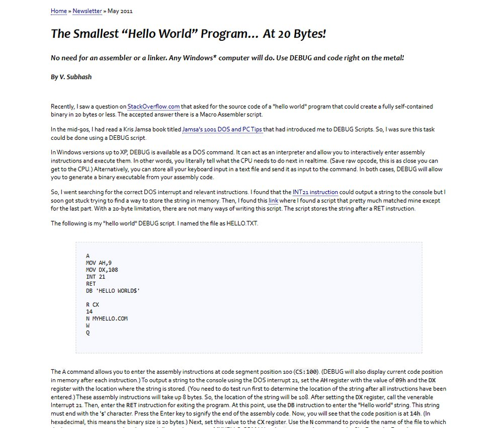

The article (V. Subhash, May 2011) creates the file `MYHELLO.COM` with the DOS DEBUG tool [R1-01]. A `.COM` file is an MS-DOS program format that predates the PE format:

- **No header.** No "MZ", no `e_lfanew`, no table of contents at all. The very first byte of the file is already a machine instruction
- **16-bit code.** The instructions are written for the 8086 CPU in 16-bit mode, not the 64-bit code that Windows 11 runs
- **DOS prints the text.** The program does not draw text itself. It calls `int 0x21`, which is how a DOS program asks the operating system to do work. Windows has no such mechanism; Windows programs call functions in DLLs

The whole file is 8 bytes of code and 12 bytes of text:

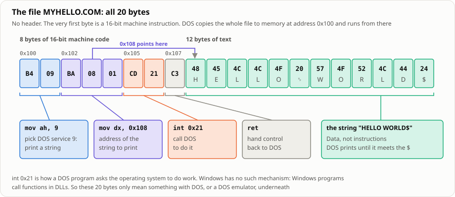

| Bytes | Instruction | Meaning |
|---|---|---|
| `B4 09` | `mov ah, 9` | Select DOS service number 9: print a string |
| `BA 08 01` | `mov dx, 0x108` | The string to print is at address `0x108`. DOS copies the file into memory at `0x100`, so byte 8 of the file is at `0x108` |
| `CD 21` | `int 0x21` | Call DOS to perform the selected service |
| `C3` | `ret` | Return control to DOS; the program ends |
| remaining 12 bytes | `HELLO WORLD$` | Data. Service 9 prints until it meets the `$` sign |

The file can be this small because DOS does all the hard work, and DOS does not require a header. The script `poc/com20/make20.py` rebuilds exactly these 20 bytes.

### What happens on Windows 11

We rebuilt the file and ran it on this machine, Windows 11 build 26300 x64, on 2026-11-18. Windows rejects it before creating a process; none of the instructions in the 20 bytes is executed [R1-M11].

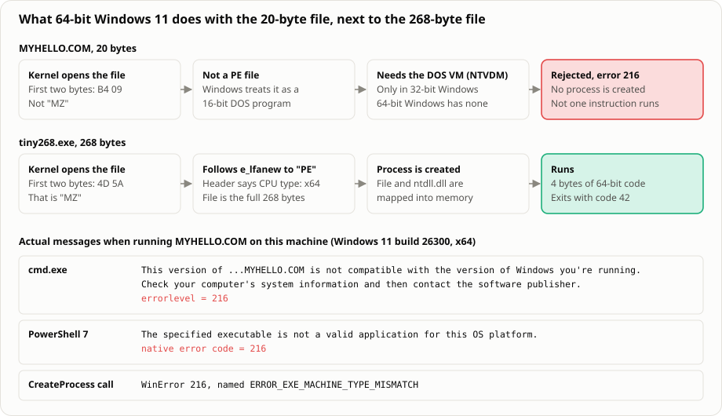

The exact message for each way of running it:

| How it is run | What Windows reports | Error code |
|---|---|---|
| Typing `.\MYHELLO.COM` in `cmd.exe` | "This version of D:\...\MYHELLO.COM is not compatible with the version of Windows you're running. Check your computer's system information and then contact the software publisher." | `errorlevel` 216 |
| Typing `.\MYHELLO.COM` in PowerShell 7 | "The specified executable is not a valid application for this OS platform." | native error code 216 |
| Calling the `CreateProcess` function from a program | WinError 216, code name `ERROR_EXE_MACHINE_TYPE_MISMATCH` | 216 |

The three messages are worded differently but share the same code 216, which means "this file was written for a different machine type". The table above is the result when run from a script, with nobody sitting in front of the window.

When run from a cmd window that is open on screen, Windows also shows a dialog titled "Unsupported 16-Bit Application" and waits for OK to be clicked:

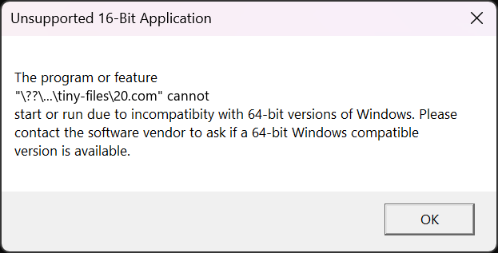

This dialog also appears for the 97-byte PE file, even though that file is not a 16-bit program. Windows uses the same message for every file that fails the header check:

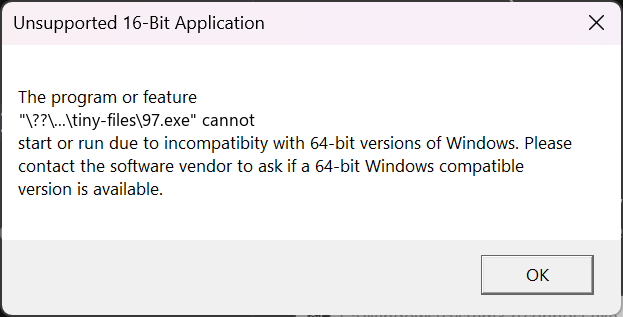

Opening the file directly by double-clicking in Explorer has not been captured.

### Try it yourself

The folder `poc/thu-file-nho` contains six ready-made files: `20.com`, `97.exe`, `133.exe`, `252.exe`, `267.exe`, `268.exe`. Double-click `chay-tat-ca.cmd` to run them one after another and see the messages; each rejected file shows the dialog pictured above, click OK to continue. Result on this machine: the first five files are all rejected with the same sentence "This version of ... is not compatible with the version of Windows you're running" and code 216; only `268.exe` runs, prints nothing and exits with code 42.

### Why it is rejected

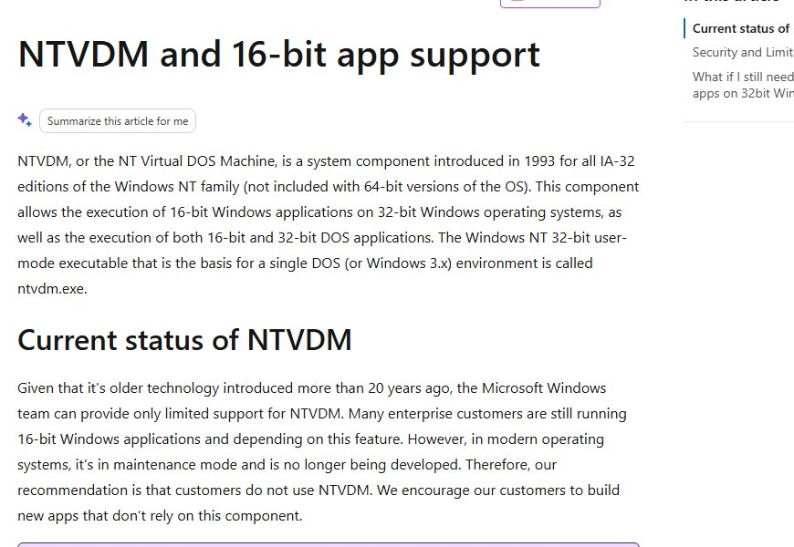

The first two bytes of the file are `B4 09`, not "MZ", so Windows does not treat it as a PE file but as a DOS program. Running a DOS program requires a DOS virtual machine called NTVDM. Microsoft states that NTVDM exists only on 32-bit Windows, and that x64 Windows "do not support 16-bit x86 code of any kind, including DOS programs" [R1-23] [R1-24]. Windows 11 ships only as 64-bit. The chain of reasoning "no MZ, so it is treated as a DOS program" is an explanation based on the documentation; the project did not trace each step inside the kernel.

To run this file today you need an emulator such as DOSBox-X [R1-29]. What actually runs then is 20 bytes plus an emulator of several MB.

### So what is the right number for Windows 11

**268 bytes.** That is the smallest file Windows 11 x64 can run by itself, with nothing else added. Compared with the 20-byte file, the extra 248 bytes are almost entirely the PE header that Windows insists on. How the 268-byte file is built is in [Part 0](#s00), section 5.

## The last 12 months

- No new PE record under 268 bytes; no report was found of a tiny exe broken by Windows 11 24H2 or 25H2 [R1-08] [R1-10] (Medium: tested directly on 26300 and on two virtual machines, 26100 and 26200)
- Microsoft's PE Format page was updated on 2026-09-10 with no change to size limits [R1-05]
- Hacker News on 2026-08-25 revisited HelloAssembly; the community still cites 97 and 133 bytes [R1-10]

## User voices

Screenshots of the three community sources quoted in this section:

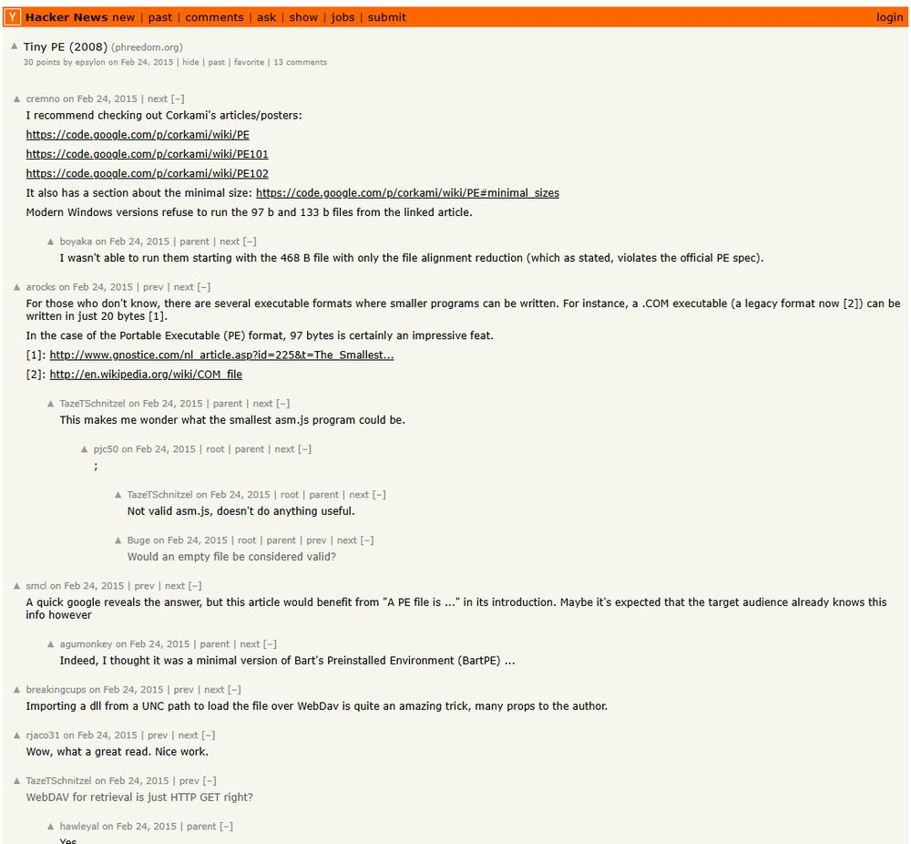

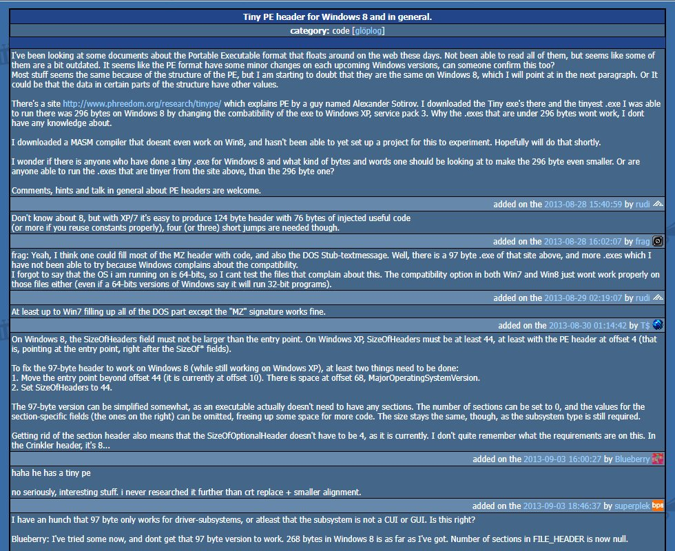

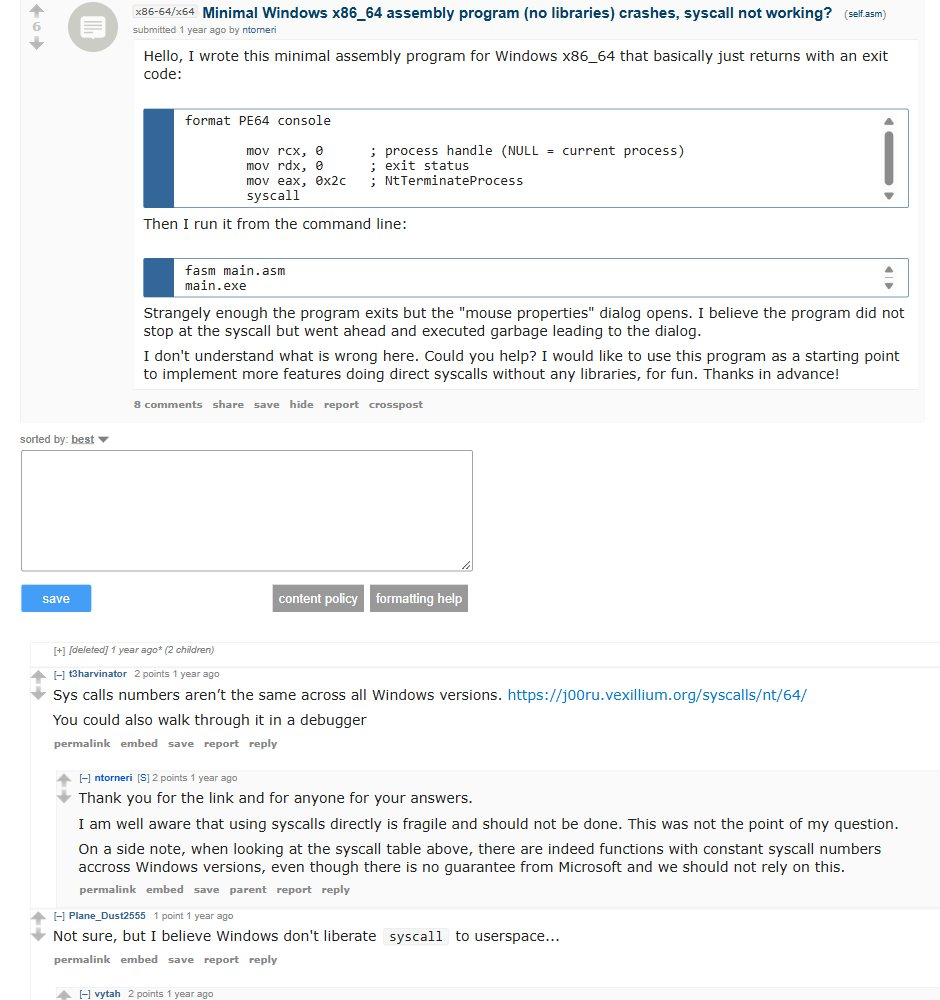

The old numbers no longer hold:

- "Modern Windows versions refuse to run the 97 b and 133 b files from the linked article." (cremno, Hacker News, 2015-02-24) [R1-09] (dated, but re-measured)
- "268 bytes in Windows 8 is as far as I've got." (superplek, pouet.net, 2013-09-03) [R1-08]

Comparison with other systems:

- "Meanwhile in the Unix world you can go as low as 45 bytes" (haunter, Hacker News, 2026-08-25) [R1-10]
- "The smallest meaningful program for MS-DOS was exactly 2 bytes: FA F4" (abcd_f, Hacker News, 2026-08-25) [R1-10]

## Gaps

- It is not yet clear why declaring subsystem version 6.3 or higher makes the 268-byte file die with 0xC000007B; keeping 6.0 runs [R1-M7]
- The 268 B PE exits with code 42 on build 26300 and on the virtual machines 24H2 build 26100.1742 and 25H2 build 26200.6584. [Virtual machine matrix](raw/windows-cross-build-matrix.md)
- Reddit could not be read in this session

<a id="s05"></a>

# RAM is decided by DLLs and windows, not by file size; idle CPU is 0 if you do not poll

> **TL;DR** In the measured samples, a minimal process costs about 0.46 MB of private commit whether the exe is 2.5 KB or carries 1 MB of untouched data. Adding user32 or a window raises the cost, and a newly opened console also brings conhost along. For CPU, a blocking wait with no work measured 0 cycles; a Sleep(1) loop has about 99 context switches/s. A context switch is not the same thing as a wakeup.

This part is the full set of measurements. A slower explanation for newcomers, with pictures, is in [Part 0](#s00), section 7.

A repeat measurement on three pairs of visible windows at second 35 gives a median Working Set of 9,160 KiB with the IME kept and 6,684 KiB with the IME disabled. Private Bytes are 1,320 and 1,052 KiB respectively. The loader, console host and trim samples also have new raw numbers. [Re-measurement data](raw/r3-window-console-trim-recheck.md).

## Three numbers for the same process

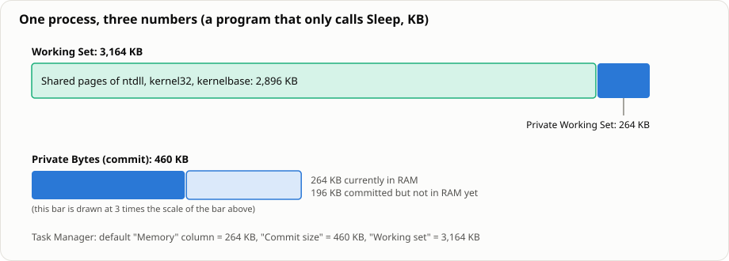

*Source: R3's measurement, program `a_sleep_gui`, median of 3 runs [M-01]*

The test program only calls `Sleep(INFINITE)`. Depending on which column you look at, it "costs" 3,164 KB, 460 KB or 264 KB:

| Metric | Value | What it means | Name in Task Manager |
|---|---|---|---|
| Working Set | 3,164 KB | Physical RAM the process is touching, including pages shared with every other process | Working set (memory) |
| Private Bytes (commit) | 460 KB | Private memory the system has committed to the process | Commit size |
| Private Working Set | 264 KB | The private part currently in RAM | Memory (default column) |

2,896 KB of the Working Set is the code of ntdll, kernel32 and kernelbase. These three DLLs are already in RAM for every process, so the real extra cost of a new process is closer to 460 KB than to 3 MB.

**Convention in this report**: Private Bytes is the main number, with Working Set alongside. Microsoft maps "Private Bytes" to Task Manager's "Commit Size" [R3-07]; Pavel Yosifovich (co-author of Windows Internals): "Commit Size is the correct column to look at" [R3-08].

## A bigger file does not mean more RAM

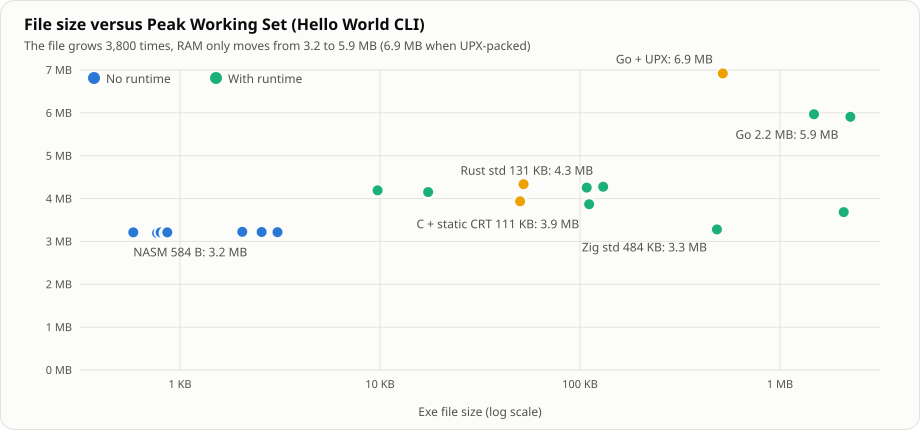

*Source: [L-01], the Hello World CLI builds, median of 7 runs*

Hypothesis H3 is **supported** [Measured] (High):

- A 2,560 B exe and a 1,051,136 B exe (with 1 MB of unused data added): Working Set 3,164 versus 3,164 KB, commit 460 versus 460 KB [M-07]
- A 140 KB exe (static CRT) uses **less** commit than a 9.7 KB exe (dynamic CRT): 504 versus 636 KB. The smaller build has to load two more DLLs [M-07]
- On the chart, the file grows 3,800 times but Peak Working Set only goes from 3.2 to 5.9 MB (6.9 MB for the UPX-compressed Go build); the increase comes from the Go runtime, not from size [L-01]

The reason: Windows maps the exe file in 4 KB pages and only loads the pages that are touched. Read-only pages of the file are shared pages and are not counted as private memory [R3-04].

The exception: compressed exes. The decompression code writes its result to private pages, so a smaller file costs more RAM. See [Part 6](#s06).

## How much each layer adds

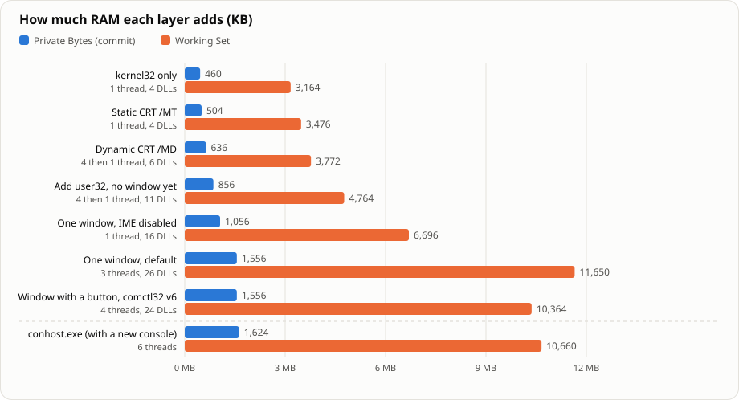

*Source: [M-01] [M-02] [M-03] [M-05], median of 3 runs, sampled 25 to 35 seconds after startup*

| Layer | Commit | Working Set | Threads | Modules (including the exe) |
|---|---|---|---|---|
| kernel32 only | 460 KB | 3,164 KB | 1 | 4 |
| Static CRT `/MT` | 504 KB | 3,476 KB | 1 | 4 |
| Dynamic CRT `/MD` | 636 KB | 3,772 KB | 4, then back to 1 | 6 |
| Add user32, no window yet | 856 KB | 4,764 KB | 4, then back to 1 | 11 |
| One window, IME disabled | 1,056 KB | 6,696 KB | 1 | 16 |
| One window, default | 1,556 KB | 11,650 KB | 3 | 26 |
| Window with a button, comctl32 v6 | 1,556 KB | 10,364 KB | 4 | 24 |
| conhost.exe (the process that comes with a new console) | 1,624 KB | 10,660 KB | 6 | not measured |

Three notable findings:

- **`ImmDisableIME(-1)` before creating the window** cuts 5.0 MB of Working Set, 0.5 MB of commit and two permanent threads. In exchange the window cannot receive input methods (Vietnamese, Chinese, Japanese). For a display-only widget nothing is lost [M-03]
- **Three extra threads appear and then vanish on their own after about 30 seconds** every time the process loads a new DLL. They are the threads of the parallel DLL loader. An exe that only uses kernel32 never has them [M-04]
- **The modern themed look (comctl32 v6) is almost free**: 68 KB more commit than v5 [M-01]

## The console is not as cheap as it seems: conhost.exe

Hypothesis H4 ("a GUI costs a few MB more than a CLI") is **only partly true** [Measured] (High):

- Measured by Working Set: GUI 9.2 to 11.6 MB versus CLI 3.2 MB. That is indeed a few MB more
- Measured by commit: GUI 1.34 to 1.56 MB versus CLI 0.47 MB. Only about 1 MB more
- But a CLI that opens a new console itself (for example when double-clicked) brings conhost.exe along: 10.7 MB more Working Set and 1.6 MB more commit. In total a resident CLI is **heavier** than a GUI without the CRT [M-05]

| How the console program is run | Accompanying process | Extra cost |
|---|---|---|
| Opens a new console (double-click, `Start-Process`) | conhost.exe | 10.7 MB WS, 1.6 MB commit, 6 threads |
| Hidden console (`CREATE_NO_WINDOW`) | conhost.exe | 7.5 MB WS, 1.2 MB commit |
| Run inside an already open terminal | none | 0 |
| `DETACHED_PROCESS` | none | 0 |

Practical conclusion: a CLI that runs and exits, called from an existing terminal, costs nothing extra. A long-running background tool should be a GUI program. A tool that needs both (like `--list` in Wireless Battery) should be a GUI and call `AttachConsole(ATTACH_PARENT_PROCESS)` when it gets arguments; the original does exactly that [R4-04].

## CPU when idle

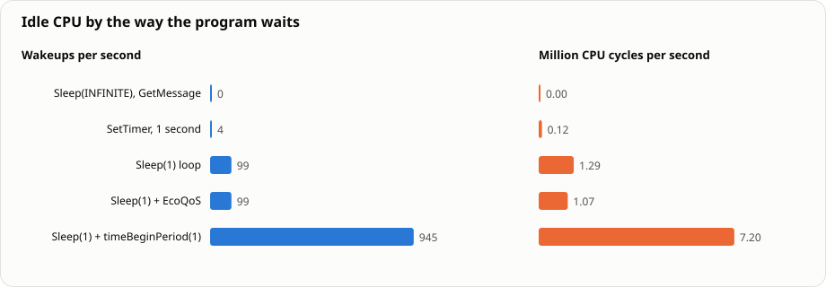

*Source: measured with `QueryProcessCycleTime` and the context switch counter, 3 runs [M-06]*

| Kind of wait | Context switches per second | Million cycles per second |
|---|---|---|
| `Sleep(INFINITE)`, `GetMessage` with no work | 0 | 0 |
| 1-second `SetTimer` + `GetMessage` | 4 | 0.12 |
| `Sleep(1)` loop | 99 | 1.29 |
| `Sleep(1)` loop + EcoQoS + low priority | 99 | 1.07 |
| `Sleep(1)` loop + `timeBeginPeriod(1)` | 945 | 7.20 |

- The numbers in the middle column are **context switches**, not a direct wakeup count. The v1.0 chart uses the label wakeup more broadly than the evidence supports; the SVG was not updated in this Markdown-only session
- CPU cost depends on both how often the process is scheduled and how much work it does each time. A cheap timer does not mean that measuring the network and drawing text are free too
- `timeBeginPeriod(1)` multiplies the number of wakeups by almost 10. Since Windows 10 version 2004, this call made by another process no longer affects your process [R3-02] [R3-11]
- EcoQoS (efficiency mode) does not reduce the number of wakeups; it only lets Windows run the process on efficiency cores or at a lower frequency [R3-01]
- The background timer measured 0.12 million cycles per second in the example. Do not convert that number to % CPU using the nominal clock rate, because the CPU can change frequency. The cost of a real widget also includes network measurement, drawing and the input queue relationship with Explorer

## Three common ways to measure wrongly

1. **Comparing by Working Set.** The number is dominated by shared DLLs. The v1.0 table is a historical baseline; the fresh-start measurements of the two original apps from 2026-11-18 are in Part 7. Always state whether you are comparing private commit or Private Working Set
2. **Trimming the Working Set to get a nice number.** Calling `SetProcessWorkingSetSize(-1,-1)` takes the Working Set from 9.1 MB to 160 KB, but commit stays at 1,332 KB. Minimizing and reopening the window once costs 808 page faults and the Working Set climbs back to 3.4 MB [M-08]
3. **Using only rounded CPU time.** In the old measurements, `TotalProcessorTime` has a step of about 15.6 ms and can report 0 even though the process used CPU [M-06]. The script `measure-resident.ps1` was fixed on 2026-11-18: it keeps the old time field and adds QueryProcessCycleTime, wall-clock duration, per-thread context switches and a memory checkpoint near second 60. The old fields do not become more accurate by themselves

One more trap: **when you sample**. The thread count is 4 at second 10 and 1 at second 35; the window's Working Set is 9.2 MB at second 25 and 11.6 MB at second 35 [M-02] [M-04].

## Checklist for the lowest RAM and CPU

| Action | Measured effect | Source |
|---|---|---|
| Use only kernel32 when possible | Floor of 460 KB commit, 1 thread | [M-01] |
| Drop the CRT, or link it statically instead of dynamically | Dynamic CRT: +176 KB commit, +3 temporary threads | [M-01] |
| Background tools use the GUI subsystem | Avoids conhost's 1.6 MB commit | [M-05] |
| `ImmDisableIME(-1)` if no typing is needed | Saves 0.5 MB commit, 3 threads down to 1 | [M-03] |
| Wait with `GetMessage`, do not poll | 0 cycles versus 1.3 million per second | [M-06] |
| Do not call `timeBeginPeriod` | Avoids 10 times the wakeups | [M-06] |
| Timers of 1 second or longer | 4 context switches per second in the example, not a directly measured wakeup count | [M-06] |
| Load DLLs once at startup | Each new load spawns 3 threads that live 30 seconds | [M-04] |
| Do not trim the Working Set periodically | Commit does not change, and it causes page faults | [M-08] |
| Do not optimize file size to reduce RAM | 2.5 KB and 1 MB: same RAM | [M-07] |

## User voices

Screenshots of two community sources. The RAM and CPU numbers in them are self-reported by the posters; the project did not re-measure them:

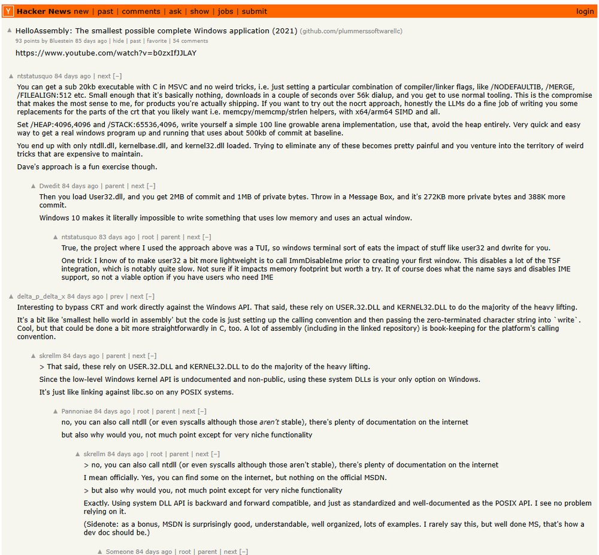

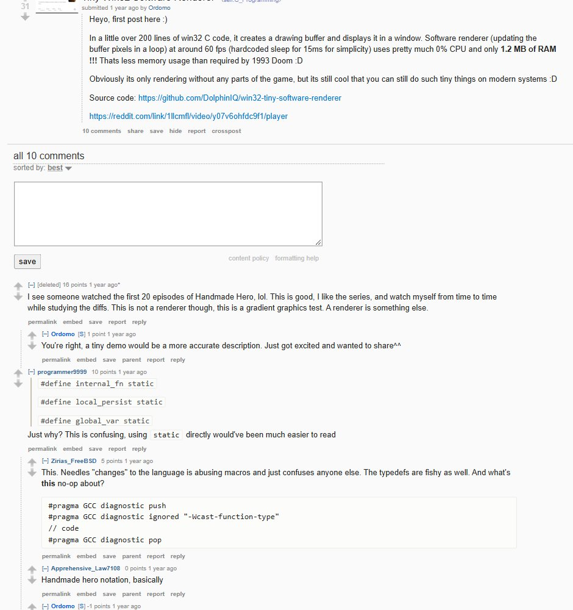

- "Windows Task Manager uses Private Working Set by default for process memory usage which does NOT include shared pages" (sedatk, Hacker News, 2026-07-04) [R3-15]
- "Then you load User32.dll, and you get 2MB of commit and 1MB of private bytes. Throw in a Message Box, and it's 272KB more private bytes" (Dwedit, Hacker News, 2026-08-25) [R1-10]. Our measurement is lower: user32 adds about 0.4 MB of commit [M-01]

## Gaps

- No admin rights: not measured with ETW, and turning off the DLL loader threads via the registry was not tried
- The case of double-clicking from Explorer when Windows Terminal is the default terminal has not been measured (it may cost tens of MB)
- Real power consumption has not been measured

<a id="s06"></a>

# Exe compression is the only thing antivirus flagged, and it saves just 229 bytes

> **TL;DR** Defender scan of 29 builds: the 27 uncompressed or UPX-packed builds were all clean; only the 2 Crinkler builds were detected as a trojan and deleted. Crinkler also takes 500 MB of RAM at run time by default. UPX cuts 52 to 65% but only makes sense for exes of tens of KB and up. The biggest long-term risk is Windows tightening the exe loader further.

## What antivirus reacts to

| Group | Builds | Size | Defender result |
|---|---|---|---|
| R1 test PE files, v1.0 baseline | 78 | 268 to 328 B | Realtime protection did not flag them; the new session separately scanned the 102 files that exist now, and the scanner exited 0 for every one |
| NASM, FASM, C, Rust, Zig without a runtime | 12 | 584 B to 3 KB | Clean |
| With a runtime (C, Rust, Zig, Go) | 12 | 9.7 KB to 2.2 MB | Clean |
| UPX-packed | 3 | 50 to 518 KB | Clean |
| **Crinkler-packed** | **2** | **351 and 355 B** | **Trojan:Win32/Crysant.RPS!MTB, deleted** |

Source: `MpCmdRun -Scan` on each file [L-02]; the Crinkler detection is recorded in `raw/defender-crinkler-detection.json` [L-03]; 78 test PE files [R1-M12]. Defender version 4.18.26100.4, signatures 1.463.337.0, dated 2026-11-17 (`raw/defender-version.txt`).

On 2026-11-18 each file of the 3 final minis and the 102 existing PEs got a custom scan: 105 scanner exit codes equal to 0, signatures 1.463.344.0. No exclusion was changed and protection was not turned off; DisableRemediation was used for the scan. All names, hashes and logs are in `research_notes/10-defender-scan.md`; this is not a SmartScreen test.

Conclusion [Measured] (High on this machine, Medium when generalized): **small size does not make AV fire; the fingerprint of a packer does.** The 268-byte file has a far stranger structure than the Crinkler build, yet it was left alone.

Hypothesis H5 ("compression raises private RAM and gets flagged by AV"): for Crinkler, the AV half is true (measured), and the standard build now has a direct RAM number. For UPX, the RAM half is mildly true (private goes up: 756 versus 624 KB, 852 versus 756 KB, 13,432 versus 12,252 KB) [L-01], and the AV half did not happen on this machine.

## Crinkler: smallest, and most expensive

Crinkler is a compressing linker made for the demoscene (the community that builds graphics programs within a 4 KB limit).

- **Still alive**: version 3.0 was released on 2026-02-27 after almost 6 years of silence; 3.0b on 2026-07-30 [R1-12]
- **Produces 32-bit exes only**; since 3.0 it requires a CPU with SSE4.2 and limits each part to 64 KB [R1-12]
- **500 MB of RAM**: the maintainer confirms "500 MB is the default size of the hash table ... The memory usage is symmetric" and advises bluntly: "If memory footprint, decompression time, or forward compatibility is in any way a concern, Crinkler is probably not the right tool for the job" (runestubbe, 2026-07-03) [R1-14]
- The `/TINYHEADER` option does not need the 500 MB table, but decompression time grows with the square of the size [R1-14]
- The `/TINYIMPORT` option can break when Windows adds new functions to system DLLs, and cannot be repaired afterwards [R1-13]
- Measured result: Hello World 355 B (CLI), 351 B (GUI), both deleted by Defender within a minute [R1-M12] [L-03]

The two old Hello World builds were built with `/TINYHEADER`, so according to the maintainer they do not use the 500 MB table; their real RAM could not be measured because the files were deleted.

Compared with the clean 584 B NASM build: 229 bytes saved, in exchange for being deleted by AV, running as 32-bit, and having to choose between 500 MB of RAM (default mode) or slow decompression (`/TINYHEADER`). For the goal "fewest resources", Crinkler goes the wrong way.

### RAM measurement of the standard build

An x86 program that waits in Sleep(INFINITE) weighs 2,560 B when linked normally and 435 B with Crinkler standard. At the 60-second mark over three runs, median Private Bytes went from 668 to 526,536 KiB, and Working Set from 4,456 to 517,996 KiB. The 378 B TINYHEADER build of the same workload was quarantined by Defender, so there is no RAM number for that mode yet. Defender in a clean 25H2 virtual machine also blocks the file with the same label, see [25H2 guest](raw/windows-25h2-guest.md). [Measurements and Defender events](raw/crinkler-resident.md).

## UPX: only meaningful for large files

UPX is a general-purpose, open-source exe packer with regular releases: 5.3.0 on 2026-10-28 [R1-17].

| Original file | Before | After UPX | Reduction |
|---|---|---|---|
| MSVC static CRT | 111,104 B | 50,176 B | 54.8% |
| Rust std | 108,032 B | 52,224 B | 51.7% |
| Go | 1,478,656 B | 517,632 B | 65.0% |

Source: [L-01]. The version used was UPX 5.1.1.

- The smallest packed build (50 KB) is still 65 times larger than the C build without CRT (768 B). Removing the runtime works better than compressing the runtime
- UPX does not reduce RAM; startup time goes up (packed Go build: 31 ms versus 7 ms) [L-01]
- The UPX project has kept an issue about AV false positives pinned since 2020 [R1-18]. On this machine the 3 UPX builds passed Defender [L-02], but other AVs may differ

kkrunchy (no longer developed) and squishy (last release 2021) count as unmaintained [R1-20] [R1-19].

## Risk register

### SmartScreen and DEP

The Defender scan results of the 2026-11-17 session are not SmartScreen results. SmartScreen also looks at file and signature reputation and at the download source; a file built locally does not reproduce the case of an Internet download carrying Mark-of-the-Web. That flow has not been tested for the minis, and Smart App Control has not been tested. See [SmartScreen](https://learn.microsoft.com/en-us/windows/security/operating-system-security/virus-and-threat-protection/microsoft-defender-smartscreen/) and [Smart App Control](https://learn.microsoft.com/en-us/windows/apps/develop/smart-app-control/code-signing-for-smart-app-control).

DEP does not mean every section is non-writable. A byte-golf build that uses an RWX code section still allows writing and executing inside that section, even with NXCOMPAT. The `/FIXED` flag removes relocations, while `/DYNAMICBASE:NO` drops the ASLR opt-in; these are two separate effects. The [DEP](https://learn.microsoft.com/en-us/windows/win32/memory/data-execution-prevention) and [FIXED](https://learn.microsoft.com/en-us/cpp/build/reference/fixed-fixed-base-address) documentation explains these mechanisms.

`poc/mini/build.ps1 -Standard` keeps default alignment, ASLR and NXCOMPAT, and does not merge sections with the byte-golf flags. Both configurations still drop `/GS`; this standard build is not yet a build with every mitigation fully enabled.

| Risk | Likelihood | Impact | Mitigation |
|---|---|---|---|
| AV false positive on a packed exe | High (already happened) | File deleted | Do not pack; use the clean class |
| An AV other than Defender flags an unsigned exe without CRT | Medium | An exclusion has to be added | Personal use only; the original Pulsar was also flagged by Malwarebytes while unsigned [R4-10] |
| A Windows update tightens the exe loader (small alignment, overlapping headers) | Low to medium | The exe stops running | Keep the source and build script; going back to the standard 512-byte alignment costs only about 1.8 KB |
| A Windows update changes the taskbar structure | Medium | The widget loses its place or disappears | Handle the `TaskbarCreated` message; accept fixing it when needed |
| ASLR lost because of `/DYNAMICBASE:NO` | Certain if the flag is used | One protection layer fewer | Acceptable for a personal tool that takes no outside data; dropping the flag costs one more section |
| A hung child widget hangs Explorer | Low | Taskbar freezes | Do no long work on the UI thread [R4-01] |
| Measurements do not repeat on another machine | Medium | Conclusions drift | Rerun `build.ps1` and the measurement scripts |

On the chance of Windows tightening further: history shows every Windows generation added checks (Vista, 7, 8) and Crinkler has had to ship fixes "several times already" [R1-13]. The 268-byte floor is tied to the size of the header structures, so it is hard to change, but the undocumented tricks (4 or 16 byte alignment) are the easiest thing to tighten [Inference].

## User voices

Screenshots of the sources quoted in this section:

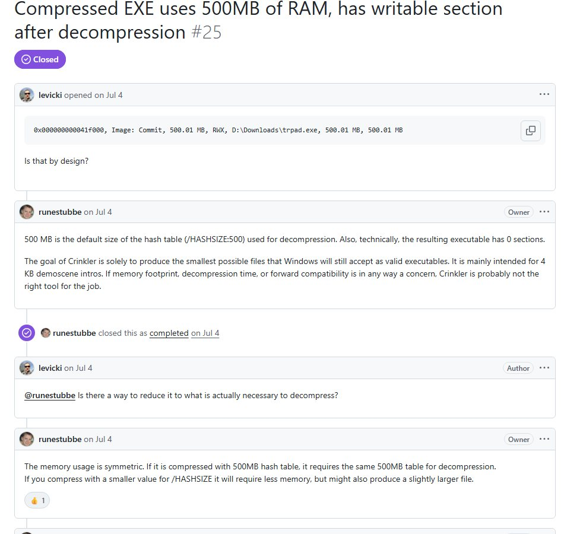

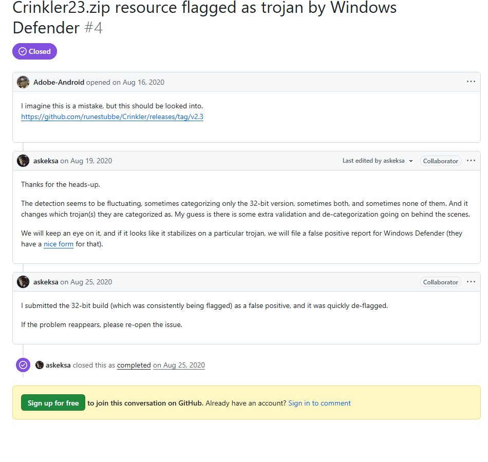


On AV:

- "AVs will complain regardless even about plain NASM/FASM executables being assembled" (Wullon, pouet.net) [R1-19]. The measurements on this machine **do not support** that claim for Defender: every NASM and FASM build was clean [L-02]
- "Malwarebytes detects the installer and the program as malware" (madscribbler, about Pulsar, 2026-10-13) [R4-10]
- "I submitted the 32-bit build ... as a false positive, and it was quickly de-flagged." (askeksa, Crinkler author, 2020-08-25) [R1-15]

On Crinkler's RAM:

- "Is that by design?" (levicki, about the 500 MB, 2026-07-03) [R1-14]

## Gaps

- RAM of Crinkler standard has been measured on the waiting program. RAM of TINYHEADER is still missing because Defender quarantined the file.
- Only one AV (Defender), one signature set, one day were tested
- Advanced protection modes (mandatory ASLR, CFG) have not been tested with small-alignment exes

<a id="s07"></a>

# The two target tools: measure a fresh start, shrink the feature set, and use one timer

> **TL;DR** The exact installed Pulsar 0.8.0 binary was measured again from a fresh start, 3 times: median Private Bytes is **13.93 MiB**, not the 34.4 MB of the process that had been running for 8 days in the earlier session. The two mini builds in C without CRT now have code and binaries. For the actual results, the targets met or missed, and the limitations, read the acceptance tables below; do not infer RAM or wakeups merely from there being one timer.

## Self-reported numbers versus measured numbers

The new measurements use KiB/MiB. The RAM comparison chart was redrawn in v1.6 with the fresh-start numbers and the two mini builds added. The two authors' READMEs do not pin down which RAM metric they mean, so this report does not compare one shared number against Private Bytes and then conclude the authors reported wrongly.

| Tool | Exe | State | Private Bytes | Working Set | Threads |
|---|---|---|---|---|---|
| Pulsar 0.8.0 installed | 3,950,080 B | Fresh start, median of 3 runs, 2026-11-18 | 14,264 KiB, 13.93 MiB | 38,028 KiB, 37.14 MiB | 17 |
| Pulsar 0.8.0, historical baseline | 3,950,080 B | Passive measurement after 8 days running, 2026-11-17 | 34,352 KiB, 33.55 MiB | 39,996 KiB, 39.06 MiB | about 20 |
| Wireless Battery 1.0.4 release | 483,840 B | Fresh start, median of 3 runs, 2026-11-18 | 3,236 KiB, 3.16 MiB | 15,996 KiB, 15.62 MiB | 6 |

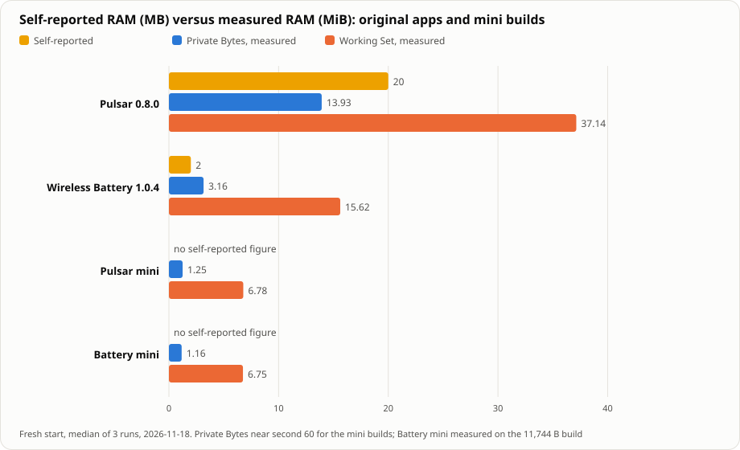
*Source: `raw/r4-fresh-cycles-20261118.jsonl`, `raw/p2-final-memory.md`, `raw/mini-measure.jsonl`. Self-reported numbers come from the two authors' READMEs*

Notes on confidence:

- The new Pulsar numbers come from the labels `pulsar-0.8.0-installed-fresh-run1..3` in `raw/r4-fresh-cycles-20261118.jsonl`, same SHA-256. The user quit Pulsar themselves to allow this measurement. The rebuild in `scratch/04/pulsar-target/` has a different size and is not mixed into the median (High for 3 runs on the same machine)
- The Wireless Battery numbers are fresh start, 3 runs, small spread (High)
- Both authors may be reading the default "Memory" column of Task Manager, which is smaller than Private Bytes [Inference]. See [Part 5](#s05)

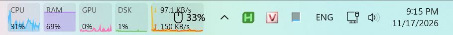

*Source: captured on the test machine on 2026-11-17 with both running; it reproduces exactly the overlap bug users reported in issue #63 [R4-12]*

## What Pulsar does inside

- **Two separate parts.** `pulsar.exe` (3.95 MB) stays resident and **does not use Slint**. Slint lives only in `pulsar-settings.exe` (28.7 MB) and `pulsar-details.exe` (17.9 MB), opened on demand [R4-01]
- **Drawing**: Direct2D draws into an in-memory image, DirectWrite draws text, then `UpdateLayeredWindow` pushes it onto a transparent window [R4-01]
- **Attaching to the taskbar**: it creates a window and then turns it into a child window of `Shell_TrayWnd`. The reason is written in the code: when Start opens, the taskbar rises above every normal window, and only a child window follows it [R4-01] [R4-09]
- **Getting the numbers**: mostly through PDH (Windows performance counters), on a separate thread, once per second [R4-01]
- **Side work that runs all the time**: a 250 ms timer checking for fullscreen, UI Automation every 0.5 to 5 seconds to find free space on the taskbar, a 2-second watchdog [R4-01]

Cost of each data source, measured with the `source_costs` example that ships in the repo [R4-20]:

| Source | Time per sample |
|---|---|
| GPU (PDH) | 0.95 ms |
| CPU (PDH) | 0.67 ms |
| Network | 0.21 ms |
| Disk (PDH) | 0.12 ms |
| RAM | 0.06 ms |
| Whole process | 1.92 ms, private RAM 7.2 to 8.0 MB |

The subtraction 34 MB minus 8 MB is no longer used to attribute 26 MB to UI cost. The `source_costs` example is a different process and the 34 MB number belongs to a build that had been running for days; that is not a measurement that removes one component at a time in the same binary at the same moment. The UI DLLs and the side timers are optimization candidates [Inference], but they have not been broken down quantitatively. The fresh-start measurement of 13.93 MiB is direct counter-evidence to the old inference.

## What Wireless Battery does inside

- Plain C++ and Win32, two threads: the UI, and one thread that queries the battery every 60 seconds [R4-04]
- Draws with GDI into an in-memory image and then `UpdateLayeredWindow`, on a child window of `Shell_TrayWnd`, placed right at the left edge of the system tray [R4-04]
- 45 drivers. Only three paths are common to all vendors: the Windows Bluetooth battery property, the HID battery standard (HID is the USB input device standard), and XInput for Xbox controllers. The rest are vendor-specific protocols [R4-04]
- The portable package bundles a 1.4 MB `headsetcontrol.exe` and **runs it every 60 seconds** [R4-04]

On your machine, `--list` sees only one device: **Logitech G502 X LIGHTSPEED, 33%**, read through Logitech's HID++ protocol (the `--list` output is copied in the notes on the two target tools; the `--dump` file is [R4-21]). That means a mini build with only the three common paths would **show nothing** on this machine; the Logitech part is mandatory.

## Proposed architecture for the mini build

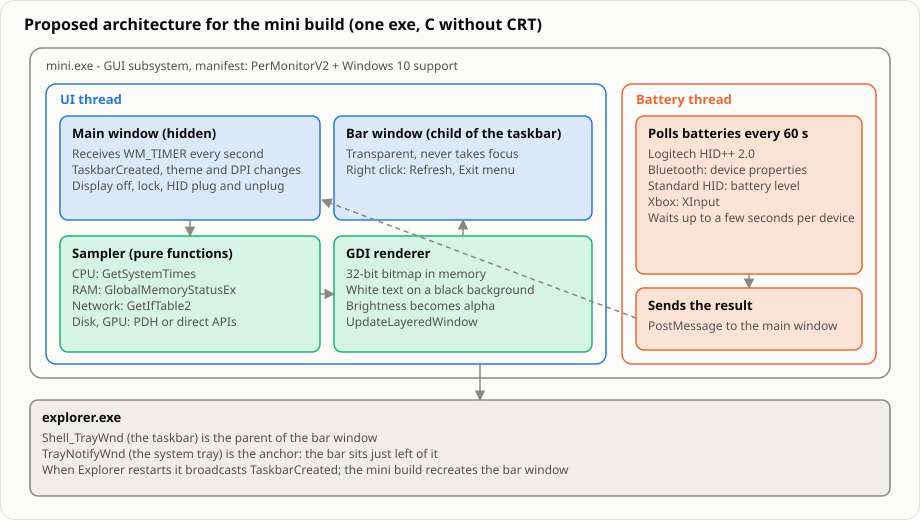

*Source: proposed architecture based on the source code of the two tools [R4-01] [R4-04]. The PoC now lives in `poc/mini/`; the differences from the proposal are noted below.*

One exe, C without CRT, GUI subsystem. The diagram has four blocks:

1. **Hidden owner window**: receives the timer and system messages. It must be a normal window (not the message-only kind) to receive the `TaskbarCreated` message when Explorer restarts
2. **Bar window**: a transparent child window on the taskbar, only for display and for right-click
3. **Sampler**: pure functions, called from the timer
4. **Battery thread**: kept separate because querying a HID device can wait up to several seconds; done on the UI thread, it could freeze the taskbar too

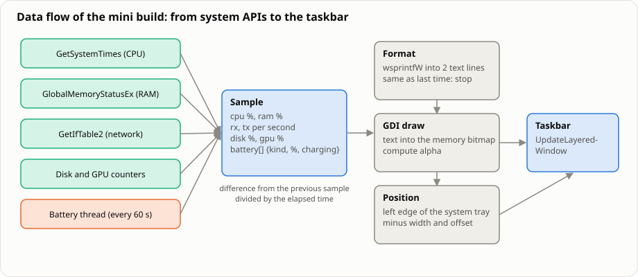

*Source: [R4-01] [R4-04]*

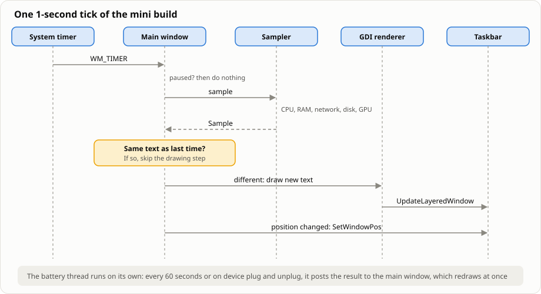

*Source: [R4-01] [R4-04]*

The PoC uses one 1-second application timer and skips drawing when the string has not changed. This does not prove the whole process wakes only once per second: the network API, GDI and Explorer's input queue can cause extra context switches. A parent/child window relationship across threads attaches the input queues automatically; see [Microsoft's explanation](https://devblogs.microsoft.com/oldnewthing/20130607-00/?p=4143). The post is from 2013 and may be dated; the effect still has to be measured for each specific configuration.

### API for each function

| Function | The original uses | The mini should use | Notes |
|---|---|---|---|
| CPU % | PDH "% Processor Utility" | `GetSystemTimes` | Reads lower than Task Manager when the CPU is in turbo; matching it requires PDH |
| RAM % | `GlobalMemoryStatusEx` | keep as is | One call |
| Network up, down | `GetIfTable2`, `GetIfEntry2` | The PoC finds the adapter with `GetIfTable2Ex`, reads counters with `GetIfEntry` | Adaptive 1 or 5 seconds; 32-bit counters, measured on 1 Gbps Ethernet |
| Disk activity % | PDH | One PDH counter, or `IOCTL_DISK_PERFORMANCE` | The second option is unverified (Medium) |
| GPU % | PDH "GPU Engine" | PDH, or `D3DKMTQueryStatistics` | The second option is unverified (Medium) |
| Drawing | Direct2D + DirectWrite | The PoC uses GDI `TextOutA`, with a transparent color-key background | No Direct2D or UI Automation, no anti-aliasing yet |
| Finding space on the taskbar | UI Automation | System tray position, the two minis avoid each other | The minimal build is meant to replace the original app; avoiding the original widgets and shifting position are in `-FullUI` |
| Pause on display off, lock | power and session notifications | keep as is | Cheap |
| Light, dark colors | registry `SystemUsesLightTheme` | keep as is | Do not use `AppsUseLightTheme`: the taskbar follows the other key |
| Logitech battery | HID++ 1.0 and 2.0 | HID++ 2.0, feature 0x1004 then 0x1000 | About 120 to 150 lines of C; mandatory for this machine |
| Bluetooth battery | device property `{104EA319-...},2` | keep as is | Could not be tested: the machine has no such device |
| Xbox controller battery | WinRT, XInput fallback | only `XInputGetBatteryInformation` | Only 4 coarse levels |

### What to drop and why

| Dropped | Reason |
|---|---|
| 13 graph styles, popup, Details window, Settings | They pull in Direct2D, Slint, 46 MB of files |
| UI Automation | Needs COM and a dedicated thread |
| Watchdog, 250 ms timer | Add wakeups; the taskbar and the minis were observed hidden in one Brave F11 session, not every kind of fullscreen was tried |
| CPU temperature | Needs a service and a driver running as admin |
| Hard disk temperature reads | Make spinning disks click constantly [R4-07] [R4-08] |
| More than 40 other vendor drivers, AirPods, Galaxy Buds, Phone Link | Your machine has none of those devices |
| HeadsetControl | Runs a 1.4 MB process every minute |

## The PoC built and its acceptance gates

The two mini builds were built in four steps, each with a measurable criterion. The rest of the report refers to them by these labels:

- **P1**: a child window on the taskbar showing static text, surviving an Explorer restart, a DPI change, a theme change
- **P2**: add CPU, RAM, network with one timer; exe under 8 KB, Private Bytes under 1.5 MB, no more than 5 CPU wakeups per second
- **P3**: add disk and GPU, within 5 percentage points of Task Manager
- **P4**: add the Logitech battery and the `--list` command, reading the same value as the original

The full criteria table, the benchmark plan, the decision gates and the backlog are in [Part 8](#s08), section "Process of building the two mini builds".

The real UI of the two mini builds on the test machine:


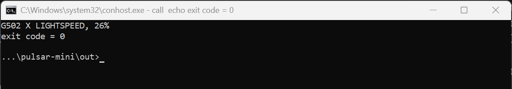

Source code and build commands: `poc/mini/README.md`. Full results: mini notes. Use the exact SHA-256 and the 3 final labels; do not pool the tuning runs.

| Binary | Bytes | Private Bytes near second 60, median of 3 runs | CPU, million cycles/s | Current features |
|---|---|---|---|---|
| Pulsar mini | 7,984 | 1,284 KiB, 1.25 MiB | 0.917 | CPU/RAM every second, network adaptive 1 or 5 seconds, taskbar |
| Battery mini before the P4 ping fix | 11,744 | 1,184 KiB, 1.16 MiB | 0.338 | Taskbar, HID++ receiver 046D:C547, 60-second worker, same exe has `--list` |
| Separate Battery CLI after the ping fix | 4,448 | Not measured resident because it exits after reading | Idle CPU not compared with the GUI | Writes one pass of results to stdout as UTF-8 |

The historical measurements for the v1.1 standard-alignment builds are 9,728 B (Pulsar) and 12,800 B (Battery). The small builds use 16-byte alignment, drop ASLR/relocations and have an RWX code section. A Defender custom scan was run on the v1.1 SHAs. v1.1 scan results.

**Pulsar v1.3 meets all three P2 thresholds** with 7,984 B, maximum Private Bytes of 1,300 KiB near second 60, and ETW 3.567, 4.150, 2.600 wakeups/s over three runs. The pre-optimization build had 9.233/s. V1.3 passes the Explorer regression 3/3. **P4 passes**: the CLI, GUI --list and the original app all read 28%, before and after a real unplug/replug. The GUI after the ping fix is 11,760 B and kept the same PID during the test. The taskbar and the widget responded in 214/214 samples, and the widget read the battery again after 16.281 seconds. P4 log. P2 notes.

P1 checked on 2026-11-18 [Measured], raw data and limits in 13-p1-validation.md:

| Test | Result |
|---|---|
| Restart the exact Explorer process that owns the taskbar, 3 times | Both minis keep their PID and create a new child themselves; back next to the tray within at most 4.781 seconds |
| 100%/150%, light/dark | All four combinations, DPI 96/144; both text lines fit the frame, transparent background, no overlap |
| Brave F11 | The full-desktop capture shows neither the taskbar nor the two widgets; F11 was exited after the test |
| S3 sleep/resume performed by the user | Windows logged the sleep/wake events; same PID/window, timer and drawing continue, the taskbar reappears |

Logging is enabled only in the `-Diagnostics` build. V1.2 kept the v1.1 binary when the P1 log was added. The 150% scale and the light theme were restored. For v1.3, the Explorer restart was retried and RGB was compared on the bitmap. Taskbar auto-hide was tried in the 25H2 virtual machine: the taskbar shrinks from 48 px to 2 px, the widget shrinks with it and still responds. A new desktop capture, multiple monitors, the taskbar reappearing step, exclusive fullscreen games and a right-click menu on the child itself were not measured further. The long run stopped after 2 hours 21 minutes with 141/141 samples responding. Inference for the unmeasured items. v1.3 regression.

## User voices

Project pages of the two original tools:

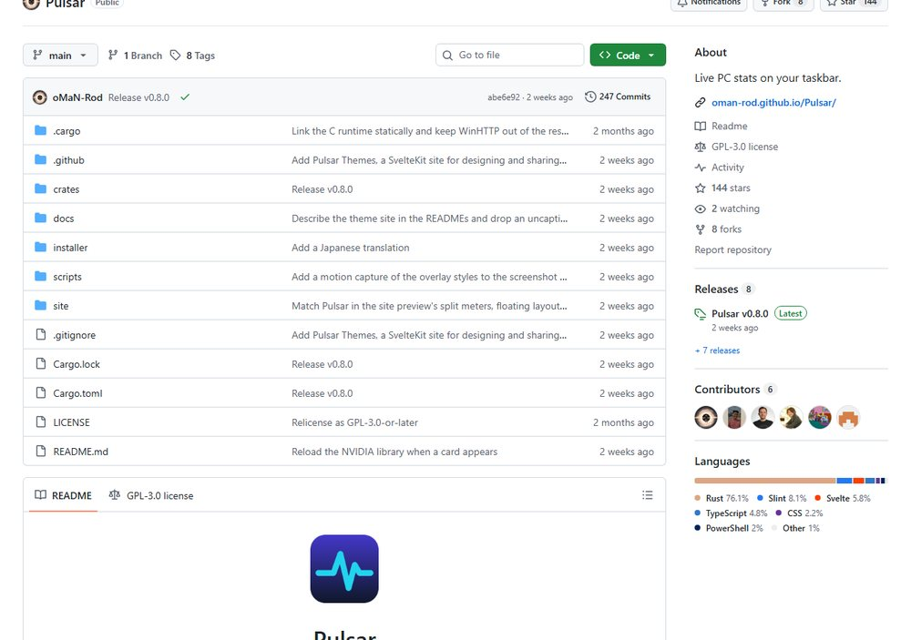

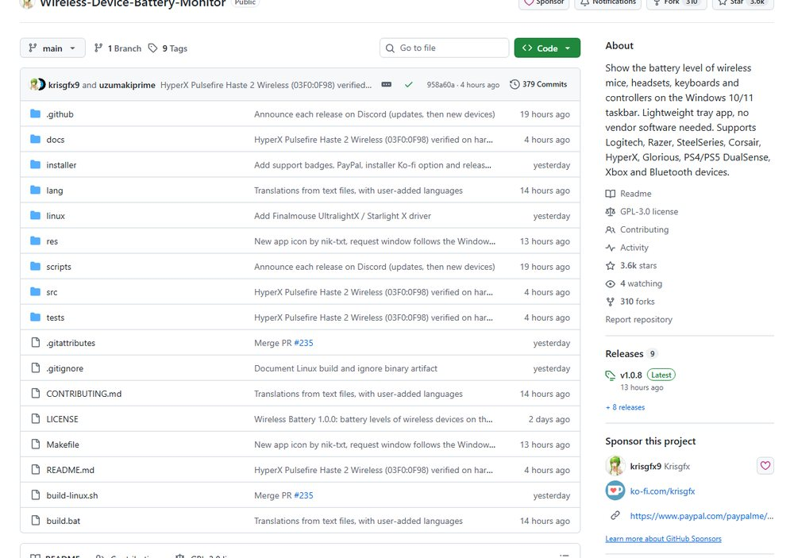

Users of the two tools do not complain about RAM or CPU; they complain about placement and side effects:

- Overlap: "The taskbar widget is always drawn immediately left of TrayNotifyWnd, so it lands on top of other taskbar monitors." (konnokai, 2026-11-17) [R4-12]
- Overlap: "Wireless Battery's taskbar widget overlaps the taskbar's Weather/Widgets button" (Hidrav3, 2026-11-17) [R4-13]
- Disk noise: user sy007007 reports that Pulsar makes a spinning disk click constantly because it reads the temperature, and compares "TrafficMonitor就没有这种问题" (TrafficMonitor does not have this problem) (2026-10-31) [R4-07]
- Fullscreen: "When entering Chrome Full Screen (youtube or F11) the graphs keeps showing on foreground" (striderskynet, 2026-10-05) [R4-11]
- Jagged text: "Is it possible to enable anti-aliasing for text?" (uncle647, 2026-11-17) [R4-18]. This is a consequence of GDI drawing, which the mini build also uses

## Gaps

- Only 3 fresh-start runs of Pulsar on one machine; there is no controlled multi-day measurement to explain how Private Bytes grows over time
- The Bluetooth and Xbox battery paths could not be tested at run time because the machine has no such devices
- The two APIs replacing PDH (disk, GPU) are inference and need to be tried in P3
- The child window did not cover Brave F11 in one real desktop test; this is not generalized to exclusive fullscreen games or multiple monitors

<a id="s08"></a>

# Methodology, limitations and next steps

> **TL;DR** The report rests on direct measurements on one machine. P1 v1.2 was accepted for Explorer, DPI/theme, one Brave F11 and one real S3. P2 v1.3 meets the RAM and ETW targets over three runs of the same SHA. Diagnostics is used for the Explorer regression, while the resource benchmark uses the exact default build. P3 and P4 have passed. Reddit sources, same-workload builds and re-measured RAM and CPU numbers have been added; testing across several Windows versions is still open.

P1 to P4 are the four steps of building the two mini builds, defined in [Part 7](#s07).

## What was done

The work was split into four research tracks, labelled R1 to R4, and one coordination track. Source citation codes start with the track label; for example R1-05 is source number 5 of track R1.

| Track | Content | Result |
|---|---|---|
| R1 | PE format, records, seed facts, packers | Done: 30 sources, 13 experiment groups |
| R2 | Toolchain comparison from published sources | `research_notes/02-toolchains-howto.md` added, 2026-11-18; six more toolchains benchmarked on the same workload |
| R3 | RAM and CPU mechanics | Done: 19 sources, 18 test programs, 3 runs each |
| R4 | Analysis of the two target tools | Done: source read, built, measured, 23 sources |
| Coordination | Hello World ladder, AV scan | Done: 27 builds, 9 toolchains |

Web searches used: R1 13, R3 about 13, R4 2, coordination 1. About 29 in total out of a budget of about 95.

## Sources reached and blocked

| Channel | Status |
|---|---|
| Web search, Microsoft Learn, GitHub (API and `gh`), Hacker News (Algolia), pouet.net, Wikimedia Commons | Reachable |
| phreedom.org (the original Tiny PE article) | Timeout; the web.archive.org copy was used |
| Reddit | Four subreddits were read through OpenCLI Browser/Brave. The JSON adapter fails when it receives HTML. |
| X | The search adapter returns nothing. The Revision results post was read from its direct URL through OpenCLI/Brave. |

## Limitations

- **The language configurations have a specific scope.** MASM, TinyCC, Odin, Nim, Free Pascal and NativeAOT were measured in addition. Each number belongs to one configuration whose stdout/exit was checked, and is not an absolute minimum. Build results.
- **Scope of the PE policy tests.** Mandatory ASLR and CFG were measured on build 26300. Per-process DEP was confirmed with an x86 fixture that reads its own flags. Edge distinguishes samples with and without reputation. Windows Shell opens a sample with reputation that still has ZoneId 3. For an unsigned sample without reputation, Windows Shell shows the Open File - Security Warning dialog and lets it run after the user confirms. Smart App Control in the on state remains untested. [Measurements](raw/smartscreen-edge.md). [Per-process matrix](raw/pe-process-mitigations.md).
- **The R3 repeat samples now have raw files.** Window, IME, loader threads, console host and trim were measured again. [Re-measured data](raw/r3-window-console-trim-recheck.md).
- Part of the original R1/R3 runs survives only as notes. The R3 re-measurement uses the same workload and distinguishes a shown window from an SW_HIDE request.
- **Community voices** now include Reddit, Hacker News, pouët.net and X. Self-reported RAM/CPU claims keep their label and scope. Posts and comments cross-checked.
- **Import comparison.** The Sleep samples by name and by ordinal are both 624 B; the PEB walk sample is 992 B. Median Private Bytes is 424 KiB for all. [Measurements](raw/pe-import-comparison.md).
- **One machine, one Windows build.** Intel Core Ultra 7 270K Plus, Windows 11 Pro 10.0.26300. The loader was additionally tested in 24H2 and 25H2 virtual machines. No AMD or ARM machine was tested
- **One antivirus, one day.** "Clean" means Defender with signatures 1.463.337.0 on 2026-11-17
- **The old CPU measurements have coarse resolution.** Since 2026-11-18 the script keeps the old field but adds QueryProcessCycleTime, the wall-clock interval and per-thread context switches. Cycles are not converted to milliseconds using the nominal clock rate.
- **The two context-switch snapshots have a limit.** A thread that has exited is no longer in the final snapshot, so the total must be marked as a lower bound. Context switches are not a direct count of wakeups.
- **Short-lived threads can be missing from both snapshots**, even when the log records 0 exited threads. The battery worker every 60 seconds is an example; per-process CPU cycles remain the main metric, and the context total of the threads still visible is not taken as a complete total.
- **The 8-day passive Pulsar number is only a historical baseline.** The new session measured again after the user quit it themselves. The 3,937,792 B rebuild is not mixed with the installed 3,950,080 B binary.
- **The two mini builds have code and binaries**, but passing each P1/P2/P4 gate must rest on the results in Part 7, not be inferred from the number of code lines or one short measurement.
- **The ETW measurement uses a collector running with administrator rights.** The v1.5 ASLR and CFG tests use child-creation flags and do not edit the registry.
- **Tools installed outside the project folder**: NASM, UPX, clang and lld were installed with pacman into `C:\msys64` before the ask-first rule existed

## Known biases

- Biased toward what can be measured: questions that can be measured get firm answers; questions about community trends are thin
- Most tiny PE sources are more than 2 years old. The main points were flagged and re-measured, but secondary details may be outdated
- The "ease of maintenance" rating in the matrix is subjective

## Hypothesis test results

| Hypothesis | Result | Evidence |
|---|---|---|
| H1 The PE floor is about 268 bytes | Supported | [R1-M1] [R1-M3] |
| H2 ASM and C without CRT differ by under 1 KB for a real app | Hello differs by 184 B; no control exists for a widget with the same features | [L-01] |
| H3 RAM does not depend on exe size | Supported | [M-07] [L-01] |
| H4 GUI costs a few MB more than CLI, CLI costs an extra conhost | Partly supported: counted as commit it is only 1 MB more; CLI plus conhost is heavier than GUI | [M-01] [M-05] |
| H5 Compression raises RAM and gets flagged by AV | Crinkler standard uses 526,536 KiB Private Bytes near second 60; Defender quarantined TINYHEADER. UPX raises private RAM in the three old samples. | [R1-14] [L-02] [L-03] |
| H6 The mini build is under 4 KB and under 2 MiB | The 7,984 B file exceeds 4 KB, RAM of 1.25 MiB passes | 3 runs of v1.3 with the same SHA-256, 2026-11-18 |
| H7 The 20-byte .COM file does not run on x64 | Supported | [R1-M11] [R1-23] |

## Process of building the two mini builds

This section is the process log of the two mini builds. The measurement results and the UI are in [Part 7](#s07).

### The initial plan and what remains

Four steps, each with a measurable criterion. The numeric targets are forecasts [Forecast], based on the measurements in [Part 5](#s05): a window with IME disabled costs 1,056 KB of commit, plus iphlpapi and hid.

| Step | What to do | Acceptance criterion |
|---|---|---|
| P1 | A child window on the taskbar showing static text, surviving an Explorer restart, a DPI change, a theme change | Text is sharp at 100% and 150%; after `taskkill explorer` and reopening it, the widget returns by itself within 5 seconds |
| P2 | Add CPU, RAM, network, one 1-second timer | Exe under 8 KB; Private Bytes under 1.5 MB at second 60; no more than 5 wakeups per second |
| P3 | Add disk and GPU; decide between PDH and direct APIs | Deviation from Task Manager of no more than 5 percentage points over 60 seconds of observation |
| P4 | Add Logitech HID++ battery and `--list` | The G502 X battery percentage matches the original. The taskbar responds when the receiver is unplugged |

Hypothesis H6 requires under 4 KB and under 2 MiB of private RAM. Pulsar v1.3 is 7,984 B, over the H6 file threshold. RAM passes with a median of 1.25 MiB.

### Benchmark plan

- Compare three builds: the original tool, the mini build, and the "empty window" baseline from [Part 5](#s05)
- Metrics: exe size; Private Bytes, Private Working Set, Working Set at second 60 (not trimmed); thread and DLL counts at second 60; CPU via `QueryProcessCycleTime` and context switch count over 60 seconds
- 3 runs per build, run sequentially (running in parallel once lost file-write data [M-09]), report the median
- The original Pulsar was measured again after the user quit it; the old passive baseline is kept separately for historical comparison

### Decision gates

| Gate | Question | If it fails |
|---|---|---|
| G1 after P1 | Is a transparent child window stable on the current Windows build? | Switch to an always-on-top floating window and accept being covered when Start opens |
| G2 after P2 | Is Private Bytes under 1.5 MB? | See which DLL pulls it in; try dropping iphlpapi |
| G3 after P3 | Is the gap between `GetSystemTimes` and Task Manager acceptable? | Use PDH and accept the extra pdh.dll |
| G4 after P4 | One combined exe or two separate exes? | Split if the battery part slows startup |

### Backlog

1. P3 passes the direct comparison with Task Manager on the current machine. Over 71 sample pairs in 70 seconds, disk deviates by at most 1 percentage point and GPU matches in all 71 pairs. The optional build is 10,912 B, median Private Bytes near second 60 is 5.95 MiB and CPU is 5.034 million cycles/s. ETW recorded 308 wakeups in 60 seconds (5.133/s). File size, RAM and wakeups exceed the P2 marks. P3 acceptance.
3. Avoid overlapping other widgets on the taskbar (the bug is reproduced in the taskbar screenshot in [Part 7](#s07))
4. Optional: ping, GPU temperature, laptop battery
5. Optional: a NASM version of P2 to compare its size with the C version

## Open questions

1. Why does a subsystem version of 6.3 or higher get a minimal PE file rejected?
2. Answered for the loader: a 16-byte-alignment exe runs in normal mode on 26300, 24H2 and 25H2, and is rejected with code 623 when mandatory ASLR requires relocations. [Virtual machine matrix](raw/windows-cross-build-matrix.md)
3. How small is a practical mini build once the manifest is counted?
4. Can `D3DKMTQueryStatistics` and `IOCTL_DISK_PERFORMANCE` replace PDH?
5. Now that the Brave F11 test has passed, does the child window behave correctly with exclusive fullscreen games and multiple monitors? Taskbar auto-hide was tried in the 25H2 virtual machine: the widget shrinks with the taskbar and still responds; the reappearing step is unconfirmed.
6. How much RAM does Crinkler TINYHEADER use in an environment that can run the file Defender quarantined on this machine? A clean 25H2 guest also blocks the file.

Questions 5 and 6 are not measured further, by the user's decision. Inference for the unmeasured items.

## Next steps, cheapest first

| Task | Effort | Question answered |
|---|---|---|
| Extend P1: multiple monitors, auto-hidden taskbar reappearing, menu on the child, exclusive fullscreen games, multi-day run | not done, inference only | Question 5; the initial P1 passed, raw data in research_notes/13-p1-validation.md |
| Visual desktop regression of Pulsar v1.3 | still open | P2 passed three ETW and RAM runs. Explorer passes 3/3, RGB matches on the bitmap |
| Test small-alignment exes in 24H2 and 25H2 virtual machines | done | Question 2, 48/48 cells identical |

Ready-to-use prompts are in `NEXT.md`.
